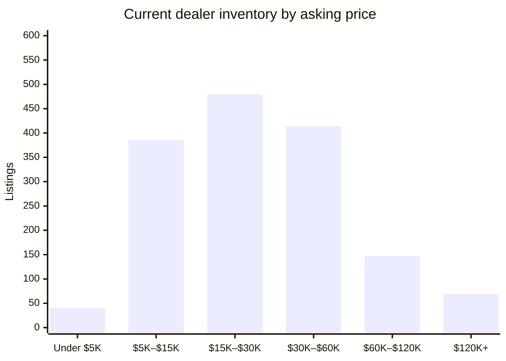

# David Webb Secondary Market — 2026-10-26

## Executive Summary

As of October 26, 2026, the David Webb secondary market presents a stable if modestly active picture: 1,604 dealer listings are live across 1,822 tracked dealer records, with 28 fresh additions over the past week absorbed against a notably higher 115 closures over the past four weeks — a ratio that points to healthy sell-through rather than inventory buildup. The dealer median ask sits at $24,000, though the week's most compelling new entry is a striking Oval Cut Sapphire Men's Ring at Legacy Vintage Jewels asking $200,000, joined by a Green Enamel and Tiger Eye Sautoir Necklace from The Back Vault at $110,500. Auction volume has been thin in the trailing 60-day window, with just two Sotheby's Hong Kong results on record — led by a Yellow Sapphire, Diamond and Enamel Demi-Parure that realized $62,356 — suggesting the primary auction houses have yet to bring significant Webb material to market this autumn. The detailed breakdowns that follow cover current availability, new arrivals, and recent closures in full.

## Currently Available

_1,604 active listings across all tracked dealer marketplaces (estate jewelers, 1stDibs, Sotheby's Buy Now, The RealReal), with a combined asking-price total of $55,947,300. This section is dealer inventory only — there is currently no live, biddable David Webb auction inventory to track; every auction-history record on file is a completed, historical sale (see "Recent Auction Sales" below)._

_That combined total is a sum of current asking prices, not an appraisal or a market valuation — it will run high wherever the same physical piece is listed on more than one platform (see Data-Quality Caveats)._

**By price**

**By category**

| Category | Count | Min | Median | Max |
|---|---|---|---|---|
| Earrings | 482 | $1,900 | $17,800 | $227,500 |
| Ring | 345 | $3,100 | $19,100 | $375,000 |
| Bracelet | 327 | $3,200 | $43,496 | $335,000 |
| Necklace | 219 | $2,796 | $39,750 | $345,000 |
| Brooch | 132 | $3,465 | $24,750 | $114,400 |
| Cufflinks | 22 | $2,250 | $6,050 | $14,800 |
| Other | 9 | $4,800 | $16,500 | $150,000 |

**By dealer**

_24 dealer(s) currently carry David Webb pieces — showing the top 20 by listing count, the rest bucketed into "Other" below._

| Dealer | Active Listings | Median Asking |
|---|---|---|
| The Back Vault | 961 | $24,000 |
| The RealReal | 116 | $13,625 |
| Oak Gem | 110 | $28,000 |
| Eric Originals & Antiques | 83 | $29,750 |
| Yafa Signed Jewels | 56 | $55,000 |
| Greenleaf & Crosby | 46 | $26,250 |
| Wilson's Estate Jewelry | 34 | $10,050 |
| Saidian & Sons | 33 | $40,000 |
| Sotheby's (Buy Now) | 27 | $18,500 |
| Legacy Vintage Jewels | 17 | $95,000 |
| Macklowe Gallery | 11 | $35,000 |
| Estate Diamond Jewelry | 9 | $15,000 |
| Joseph Saidian and Sons | 7 | $60,000 |
| Kentshire | 6 | $36,000 |
| Louis Martin | 4 | $24,500 |
| A. Brandt + Son | 3 | $14,995 |
| Stella Rubin Jewelry | 3 | $9,600 |
| Select Antique Jewelry Inc | 2 | $58,000 |
| Lawrence Jeffrey | 2 | $15,400 |
| Eric Originals and Antiques LTD | 2 | $18,485 |
| Other (4 additional dealers) | 4 | $79,000 |

## Trends by Motif & Material

_Tags are keyword-matched from each piece's own listing text against David Webb's known design vocabulary (Zodiac, animal/creature pieces, fishscale, rock crystal, enamel, carved hardstone, etc.) — a piece can carry several tags. Tags with fewer than 5 matching records are omitted as too thin to be meaningful. Click a tag to see those exact pieces in the live database._

**Auction (sold prices)**

| Tag | Count | Min | Median | Max |
|---|---|---|---|---|
| [Enamel](https://david-webb-new-york.github.io/david-webb-market-agent/?tag=Enamel) | 950 | $719 | $10,963 | $232,000 |
| [Cabochon](https://david-webb-new-york.github.io/david-webb-market-agent/?tag=Cabochon) | 936 | $1,250 | $16,380 | $508,000 |
| [Carved Hardstone](https://david-webb-new-york.github.io/david-webb-market-agent/?tag=Carved%20Hardstone) | 557 | $875 | $15,000 | $693,000 |
| [Hammered Gold](https://david-webb-new-york.github.io/david-webb-market-agent/?tag=Hammered%20Gold) | 428 | $1,250 | $11,420 | $201,600 |
| [Animal/Creature](https://david-webb-new-york.github.io/david-webb-market-agent/?tag=Animal%2FCreature) | 416 | $719 | $12,155 | $218,500 |
| [Cuff/Bangle](https://david-webb-new-york.github.io/david-webb-market-agent/?tag=Cuff%2FBangle) | 361 | $1,314 | $23,750 | $218,500 |
| [Bombé](https://david-webb-new-york.github.io/david-webb-market-agent/?tag=Bomb%C3%A9) | 201 | $1,250 | $12,454 | $1,426,500 |
| [Rock Crystal](https://david-webb-new-york.github.io/david-webb-market-agent/?tag=Rock%20Crystal) | 177 | $954 | $12,516 | $106,250 |
| [Maltese Cross](https://david-webb-new-york.github.io/david-webb-market-agent/?tag=Maltese%20Cross) | 36 | $3,125 | $20,000 | $134,500 |
| [Door Knocker](https://david-webb-new-york.github.io/david-webb-market-agent/?tag=Door%20Knocker) | 29 | $3,125 | $9,525 | $106,250 |
| [Zodiac](https://david-webb-new-york.github.io/david-webb-market-agent/?tag=Zodiac) | 27 | $812 | $8,713 | $90,000 |
| [Shell/Starfish](https://david-webb-new-york.github.io/david-webb-market-agent/?tag=Shell%2FStarfish) | 17 | $1,700 | $5,175 | $146,500 |

**Current dealer inventory (asking prices)**

| Tag | Count | Min | Median | Max |
|---|---|---|---|---|
| [Enamel](https://david-webb-new-york.github.io/david-webb-market-agent/?tag=Enamel) | 495 | $2,796 | $21,375 | $335,000 |
| [Carved Hardstone](https://david-webb-new-york.github.io/david-webb-market-agent/?tag=Carved%20Hardstone) | 294 | $3,850 | $35,000 | $289,500 |
| [Cabochon](https://david-webb-new-york.github.io/david-webb-market-agent/?tag=Cabochon) | 263 | $3,200 | $27,900 | $335,000 |
| [Animal/Creature](https://david-webb-new-york.github.io/david-webb-market-agent/?tag=Animal%2FCreature) | 236 | $3,100 | $22,048 | $335,000 |
| [Hammered Gold](https://david-webb-new-york.github.io/david-webb-market-agent/?tag=Hammered%20Gold) | 174 | $3,056 | $22,500 | $143,000 |
| [Cuff/Bangle](https://david-webb-new-york.github.io/david-webb-market-agent/?tag=Cuff%2FBangle) | 173 | $3,200 | $37,700 | $288,000 |
| [1970s](https://david-webb-new-york.github.io/david-webb-market-agent/?tag=1970s) | 145 | $3,100 | $27,900 | $289,500 |
| [1960s](https://david-webb-new-york.github.io/david-webb-market-agent/?tag=1960s) | 88 | $3,100 | $29,625 | $265,000 |
| [Rock Crystal](https://david-webb-new-york.github.io/david-webb-market-agent/?tag=Rock%20Crystal) | 64 | $4,800 | $38,000 | $225,000 |
| [Bombé](https://david-webb-new-york.github.io/david-webb-market-agent/?tag=Bomb%C3%A9) | 56 | $6,400 | $18,150 | $214,500 |
| [1980s](https://david-webb-new-york.github.io/david-webb-market-agent/?tag=1980s) | 56 | $4,250 | $22,700 | $81,200 |
| [Door Knocker](https://david-webb-new-york.github.io/david-webb-market-agent/?tag=Door%20Knocker) | 47 | $8,713 | $20,800 | $214,500 |
| [Zodiac](https://david-webb-new-york.github.io/david-webb-market-agent/?tag=Zodiac) | 20 | $4,500 | $18,150 | $64,300 |
| [Shell/Starfish](https://david-webb-new-york.github.io/david-webb-market-agent/?tag=Shell%2FStarfish) | 14 | $7,200 | $12,100 | $30,700 |
| [Maltese Cross](https://david-webb-new-york.github.io/david-webb-market-agent/?tag=Maltese%20Cross) | 13 | $27,300 | $35,700 | $65,000 |

## New in the Last Week

_28 dealer listing(s) first seen in the last 7 days, across all sources and price points — showing the 20 biggest by price._

| Piece | Category | Dealer | Price | Date |
|---|---|---|---|---|
| [David Webb Oval Cut Sapphire Men's Ring](https://legacyvintagejewels.com/products/david-webb-oval-cut-sapphire-mens-ring) | Ring | Legacy Vintage Jewels | $200,000 | 2026-10-20 |
| [David Webb 18K Yellow Gold Green Enamel And Tiger Eye Sautoir Necklace](https://thebackvault.com/products/david-webb-18k-yellow-gold-green-enamel-and-tiger-eye-sautoir-necklace-j10578) | Necklace | The Back Vault | $110,500 | 2026-10-19 |
| [David Webb Stud Diamond And Black Enamel Necklace](https://www.1stdibs.com/jewelry/necklaces/link-necklaces/david-webb-stud-diamond-black-enamel-necklace/id-j_15259522/) | Necklace | The Back Vault | $109,000 | 2026-10-22 |
| [David Webb 18K Yellow Gold Repousse Hippocuff Bracelet](https://www.1stdibs.com/jewelry/bracelets/cuff-bracelets/david-webb-18k-yellow-gold-repousse-hippocuff-bracelet/id-j_30923072/) | Bracelet | RT Jewelers Inc | $100,000 | 2026-10-20 |
| [David Webb Turquoise Lapis Lazuli Diamond Necklace](https://www.1stdibs.com/jewelry/necklaces/link-necklaces/david-webb-turquoise-lapis-lazuli-diamond-necklace/id-j_26617312/) | Necklace | NALLY JEWELS | $98,000 | 2026-10-22 |
| [David Webb Carved Emerald and Diamond Ring](https://www.1stdibs.com/jewelry/rings/cocktail-rings/david-webb-carved-emerald-diamond-ring/id-j_27931262/) | Ring | Joseph Saidian and Sons | $95,000 | 2026-10-19 |
| [David Webb Carved Ruby And Diamond Brooch](https://legacyvintagejewels.com/products/david-webb-carved-rubie-and-diamond-brooch) | Brooch | Legacy Vintage Jewels | $85,000 | 2026-10-20 |
| [David Webb Emerald and Diamond Brooch](https://legacyvintagejewels.com/products/david-brooch-emerald-leaf-brooch) | Brooch | Legacy Vintage Jewels | $80,000 | 2026-10-20 |
| [David Webb Jade and Enamel Earrings](https://www.1stdibs.com/jewelry/earrings/clip-on-earrings/david-webb-jade-enamel-earrings/id-j_30079972/) | Earrings | Joseph Saidian and Sons | $60,000 | 2026-10-19 |
| [David Webb Azurmalachite, Ruby, and Diamond Maltese Cross Brooch](https://legacyvintagejewels.com/products/david-webb-azurmalachite-ruby-and-diamond-maltese-cross-brooch) | Brooch | Legacy Vintage Jewels | $55,000 | 2026-10-20 |
| [David Webb Pearl Amethyst and Chalcedony Necklace](https://www.1stdibs.com/jewelry/necklaces/multi-strand-necklaces/david-webb-pearl-amethyst-chalcedony-necklace/id-j_25791342/) | Necklace | Joseph Saidian and Sons | $55,000 | 2026-10-26 |
| [David Webb Turquoise Cabochon Link Necklace](https://legacyvintagejewels.com/products/david-webb-turquoise-cabochon-link-necklace) | Necklace | Legacy Vintage Jewels | $50,000 | 2026-10-20 |
| [18K Graduating Rope Link Necklace](https://www.therealreal.com/products/jewelry/necklaces/chain/david-webb-18k-graduating-rope-link-necklace-wzss6) | Necklace | The RealReal | $35,995 | 2026-10-22 |
| [David Webb 18K Yellow Gold Double Frog Black Enamel Ruby Eyes Bangle Bracelet](https://thebackvault.com/products/david-webb-18k-yellow-gold-double-frog-black-enamel-ruby-eyes-bangle-bracelet-j10563) | Bracelet | The Back Vault | $28,600 | 2026-10-19 |
| [Diamond Hinged Cuff Bracelet](https://www.therealreal.com/products/details/jewelry/bracelets/bangle/david-webb-diamond-hinged-cuff-bracelet-vysvr) | Bracelet | The RealReal | $28,495 | 2026-10-19 |
| [18K Jadeite, Diamond, Ruby & Enamel Brooch](https://www.therealreal.com/products/details/jewelry/necklaces/pendant-necklace/david-webb-18k-jadeite-diamond-ruby-enamel-brooch-wxpeu) | Brooch | The RealReal | $25,000 | 2026-10-22 |
| [18K Lapis Lazuli & Diamond Enamel Cocktail Ring](https://www.therealreal.com/products/details/jewelry/rings/cocktail-ring/david-webb-18k-lapis-lazuli-diamond-enamel-cocktail-ring-wzsqy) | Ring | The RealReal | $16,500 | 2026-10-26 |
| [18K Quartz & Diamond Clip-on Earrings](https://www.therealreal.com/products/jewelry/earrings/clip-on/david-webb-18k-quartz-diamond-clip-on-earrings-x0f33) | Earrings | The RealReal | $15,795 | 2026-10-19 |
| [18K 1.60ctw Diamond & Enamel Cocktail Ring](https://www.therealreal.com/products/jewelry/rings/cocktail-ring/david-webb-18k-1-60ctw-diamond-enamel-cocktail-ring-wxpe4) | Ring | The RealReal | $15,000 | 2026-10-20 |
| [18K Diamond Hammered Cocktail Ring](https://www.therealreal.com/products/jewelry/rings/cocktail-ring/david-webb-18k-diamond-hammered-cocktail-ring-wqc23) | Ring | The RealReal | $14,995 | 2026-10-19 |

_...and 8 more. [See the full list in the live dashboard](https://david-webb-new-york.github.io/david-webb-market-agent/?type=dealer)._

## Closed / Sold in the Last 4 Weeks

_115 dealer listing(s) delisted in the last 28 days — "closed" usually but not always means sold (see Data-Quality Caveats)._

| Piece | Category | Dealer | Price | Date |
|---|---|---|---|---|
| [David Webb Pair of Emerald and Diamond Pendent Ear Clips](https://legacyvintagejewels.com/products/pair-of-emerald-and-diamond-pendent-ear-clips) | Necklace | Legacy Vintage Jewels | $130,000 | 2026-08-07 |
| [David Webb Multigem and Diamond Floral Gold Brooch](https://www.1stdibs.com/jewelry/brooches/brooches/david-webb-multigem-diamond-floral-gold-brooch/id-j_30067222/) | Brooch | Legacy Vintage Jewels | $125,000 | 2026-08-11 |
| [David Webb Multigem and Diamond Floral Gold Brooch](https://www.1stdibs.com/jewelry/brooches/brooches/david-webb-multigem-diamond-floral-gold-brooch/id-j_29572672/) | Brooch | Legacy Vintage Jewels | $125,000 | 2026-09-03 |
| [David Webb Stud Diamond And Black Enamel Necklace](https://www.1stdibs.com/jewelry/necklaces/link-necklaces/david-webb-stud-diamond-black-enamel-necklace/id-j_15259522/) | Necklace | The Back Vault | $109,000 | 2026-10-22 |
| [David Webb Carved Emerald and Diamond Ring](https://www.1stdibs.com/jewelry/rings/cocktail-rings/david-webb-carved-emerald-diamond-ring/id-j_27931262/) | Ring | Joseph Saidian and Sons | $95,000 | 2026-10-19 |
| [David Webb Bird Brooch with Sapphire, Emerald, Ruby, and Diamonds](https://www.1stdibs.com/jewelry/brooches/brooches/david-webb-bird-brooch-sapphire-emerald-ruby-diamonds/id-j_25153132/) | Brooch | Legacy Vintage Jewels | $80,000 | 2026-08-12 |
| [David Webb Carved Jade Diamond and Ruby Seahorse Brooch](https://www.1stdibs.com/jewelry/brooches/brooches/david-webb-carved-jade-diamond-ruby-seahorse-brooch/id-j_29572622/) | Brooch | Legacy Vintage Jewels | $80,000 | 2026-08-18 |
| [David Webb Convertible Yellow Gold Chain](https://www.1stdibs.com/jewelry/necklaces/chain-necklaces/david-webb-convertible-yellow-gold-chain/id-j_24467672/) | Necklace | M.S. Rau | $54,500 | 2026-09-04 |
| [David Webb Carved Jade & Diamond Disc Brooch](https://www.1stdibs.com/jewelry/brooches/brooches/david-webb-carved-jade-diamond-disc-brooch/id-j_25550452/) | Brooch | Legacy Vintage Jewels | $30,000 | 2026-08-19 |
| [David Webb Enamel, 18K & Platinum Tire Ring signed with a David Webb Certificate](https://www.1stdibs.com/jewelry/rings/dome-rings/david-webb-enamel-18k-platinum-tire-ring-signed-david-webb-certificate/id-j_24069042/) | Ring | Pierre/Famille | $22,320 | 2026-08-10 |
| [David Webb Diamond Leaf Earrings](https://www.1stdibs.com/jewelry/earrings/clip-on-earrings/david-webb-diamond-leaf-earrings/id-j_27874372/) | Earrings | Macklowe Gallery Jewelry | $16,500 | 2026-08-17 |
| [David Webb Three Stone Cabochon and Diamond Earrings](https://www.1stdibs.com/jewelry/earrings/clip-on-earrings/david-webb-three-stone-cabochon-diamond-earrings/id-j_26293322/) | Earrings | Legacy Vintage Jewels | $15,000 | 2026-10-14 |
| [David Webb Ruby and Diamond Lion Bangle Bracelet](https://saidiansons.com/products/david-webb-ruby-and-diamond-lion-bangle-bracelet) | Bracelet | Saidian & Sons | n/a | 2026-08-07 |
| [David Webb Rubellite &amp; Turquoise Diamond Necklace & Earrings Set](https://saidiansons.com/products/david-webb-rubellite-amp-turquoise-diamond-necklace-amp-earrings-set) | Necklace | Saidian & Sons | n/a | 2026-08-07 |
| [David Webb Carved Emerald and Diamond Ring](https://saidiansons.com/products/david-webb-carved-emerald-and-diamond-ring-1) | Ring | Saidian & Sons | n/a | 2026-08-07 |
| [David Webb Turquoise Lapis Lazuli Diamond Necklace](https://www.1stdibs.com/jewelry/necklaces/link-necklaces/david-webb-turquoise-lapis-lazuli-diamond-necklace/id-j_26617312/) | Necklace | NALLY JEWELS | $98,000 | 2026-10-22 |
| [David Webb White Enamel, Diamond And Ruby Double Panthere Head Bracelet.](https://www.1stdibs.com/jewelry/bracelets/bangles/david-webb-white-enamel-diamond-ruby-double-panthere-head-bracelet/id-j_29666452/) | Bracelet | NALLY JEWELS | $85,000 | 2026-10-08 |
| [David Webb White Enamel, Diamond and Lapis Fish Bracelet In 18k](https://www.1stdibs.com/jewelry/bracelets/cuff-bracelets/david-webb-white-enamel-diamond-lapis-fish-bracelet-18k/id-j_28110872/) | Bracelet | NALLY JEWELS | $79,500 | 2026-10-08 |
| [David Webb Amethyst and 18k Hammered Gold Cuff Bracelet](https://www.1stdibs.com/jewelry/bracelets/cuff-bracelets/david-webb-amethyst-18k-hammered-gold-cuff-bracelet/id-j_30234382/) | Bracelet | Tiina Smith Jewelry | $72,000 | 2026-10-05 |
| [David Webb Celtic Crescent Convertible Necklace / Brooch i](https://www.1stdibs.com/jewelry/necklaces/link-necklaces/david-webb-celtic-crescent-convertible-necklace-brooch-i/id-j_29945312/) | Necklace | NALLY JEWELS | $69,500 | 2026-10-08 |
| [David Webb Diamond, Coral & White Enamel Frog Brooch](https://www.1stdibs.com/jewelry/brooches/brooches/david-webb-diamond-coral-white-enamel-frog-brooch/id-j_24885662/) | Brooch | NALLY JEWELS | $58,000 | 2026-10-08 |
| [David Webb Turquoise Cabochon Link Necklace](https://legacyvintagejewels.com/products/david-webb-turquoise-cabochon-link-necklace) | Necklace | Legacy Vintage Jewels | $50,000 | 2026-10-20 |
| [David Webb "VIRGO"  Diamond & Gold Brooch/Pendant](https://www.1stdibs.com/jewelry/brooches/brooches/david-webb-virgo-diamond-gold-brooch-pendant/id-j_24196512/) | Necklace | NALLY JEWELS | $32,500 | 2026-10-08 |
| [David Webb Enamel, 18K & Platinum Tire Ring signed with a David Webb Certificate](https://www.1stdibs.com/jewelry/rings/cocktail-rings/david-webb-enamel-18k-platinum-tire-ring-signed-david-webb-certificate/id-j_30112182/) | Ring | Pierre/Famille | $20,720 | 2026-08-13 |
| [David Webb 0.50 Carat Round Brilliant Diamond and Striped Enamel Cocktail Ring](https://www.1stdibs.com/jewelry/rings/cocktail-rings/david-webb-050-carat-round-brilliant-diamond-striped-enamel-cocktail-ring/id-j_17092542/) | Ring | Charles Schwartz & Son | $13,500 | 2026-08-17 |
| [18K Sapphire Ram Cocktail Ring](https://www.therealreal.com/products/details/jewelry/rings/cocktail-ring/david-webb-18k-sapphire-ram-cocktail-ring-v9wib) | Ring | The RealReal | $6,800 | 2026-09-22 |
| [David Webb Pearl, Diamond, Onyx & Rock Crystal Necklace](https://www.1stdibs.com/jewelry/necklaces/pendant-necklaces/david-webb-pearl-diamond-onyx-rock-crystal-necklace/id-j_29659532/) | Necklace | Odeon Collection | $42,000 | 2026-09-08 |
| [David Webb Diamond & 18K Gold Ring](https://www.1stdibs.com/jewelry/rings/engagement-rings/david-webb-diamond-18k-gold-ring/id-j_27945582/) | Ring | 66 mint | $17,500 | 2026-08-10 |
| [David Webb Black Enamel and 18K Yellow Gold Bracelet](https://www.1stdibs.com/jewelry/bracelets/link-bracelets/david-webb-black-enamel-18k-yellow-gold-bracelet/id-j_23210762/) | Bracelet | Charles Schwartz & Son | $17,000 | 2026-08-17 |
| [18K 2.91ctw Diamond Enamel Bangle Bracelet](https://www.therealreal.com/products/details/jewelry/bracelets/bangle/david-webb-18k-2-91ctw-diamond-enamel-bangle-bracelet-trkec) | Bracelet | The RealReal | $15,597 | 2026-08-12 |
| [David Webb Multi Row Diamond Stud Earrings in 18 Karat Yellow Gold and Platinum](https://www.1stdibs.com/jewelry/earrings/stud-earrings/david-webb-multi-row-diamond-stud-earrings-18-karat-yellow-gold-platinum/id-j_27044782/) | Earrings | Secret Jewelry Source | $14,125 | 2026-10-21 |
| [David Webb Gold and Diamonds Ring](https://www.1stdibs.com/jewelry/rings/fashion-rings/david-webb-gold-diamonds-ring/id-j_25886562/) | Ring | Stella Rubin Jewelry | $6,800 | 2026-09-18 |
| [18K Enamel Wolf Stud Earrings](https://www.therealreal.com/products/jewelry/earrings/stud/david-webb-18k-enamel-wolf-stud-earrings-ubdoc) | Earrings | The RealReal | $6,157 | 2026-08-12 |
| [David Webb Green-Blue Enamel Emerald Diamond Pendant Brooch](https://www.1stdibs.com/jewelry/brooches/brooches/david-webb-green-blue-enamel-emerald-diamond-pendant-brooch/id-j_23451002/) | Necklace | Greenleaf & Crosby | $39,500 | 2026-09-07 |
| [David Webb Zebra Ring, Diamond and Enamel 18K Yellow Gold Platinum](https://www.1stdibs.com/jewelry/rings/cocktail-rings/david-webb-zebra-ring-diamond-enamel-18k-yellow-gold-platinum/id-j_28437452/) | Ring | Aryamehr Fine Jewelry | $19,300 | 2026-08-10 |
| [David Webb Lapis Link Yellow Gold Necklace](https://oakgem.com/products/david-webb-lapis-link-yellow-gold-necklace) | Necklace | Oak Gem | $18,000 | 2026-08-07 |
| [Vintage David Webb Enamel 18K Yellow Gold Statement Ring](https://www.1stdibs.com/jewelry/rings/cocktail-rings/vintage-david-webb-enamel-18k-yellow-gold-statement-ring/id-j_29898252/) | Ring | Antinori di Sanpietro | $15,600 | 2026-09-21 |
| [David Webb Black Enamel Pyramid Trellis Dome Earrings](https://www.1stdibs.com/jewelry/earrings/clip-on-earrings/david-webb-black-enamel-pyramid-trellis-dome-earrings/id-j_16698822/) | Earrings | Greenleaf & Crosby | $11,600 | 2026-09-21 |
| [David Webb 1970s 18K Gold Enamel Leaf Dome Statement Ring](https://www.1stdibs.com/jewelry/rings/cocktail-rings/david-webb-1970s-18k-gold-enamel-leaf-dome-statement-ring/id-j_25360572/) | Ring | Dover Jewelry | $11,700 | 2026-08-13 |
| [David Webb Cabochon Emerald and Diamond Bracelet](https://ericoriginals.com/products/david-webb-cabochon-emerald-and-diamond-bracelet) | Bracelet | Eric Originals & Antiques | $410,000 | 2026-08-07 |
| [18K Twisted Link Bracelet](https://www.therealreal.com/products/jewelry/bracelets/link/david-webb-18k-twisted-link-bracelet-vdsys) | Bracelet | The RealReal | $35,500 | 2026-08-12 |
| [Diamond Hinged Cuff Bracelet](https://www.therealreal.com/products/jewelry/bracelets/bangle/david-webb-diamond-hinged-cuff-bracelet-vysvr) | Bracelet | The RealReal | $28,495 | 2026-08-28 |
| [Vintage David Webb 18K Gold Black Enamel and Diamond Earrings](https://www.1stdibs.com/jewelry/earrings/clip-on-earrings/vintage-david-webb-18k-gold-black-enamel-diamond-earrings/id-j_27375042/) | Earrings | Benchmark of Palm Beach | $19,750 | 2026-10-16 |
| [Vintage David Webb Yellow Gold, Platinum, Diamond, Enamel & South Sea Pearl Ring](https://www.1stdibs.com/jewelry/rings/cocktail-rings/vintage-david-webb-yellow-gold-platinum-diamond-enamel-south-sea-pearl-ring/id-j_29395322/) | Ring | Benchmark of Palm Beach | $15,500 | 2026-10-16 |
| [Vintage David Webb 18K Yellow Gold Bamboo Motif White Enamel Large Scale Ring](https://www.1stdibs.com/jewelry/rings/cocktail-rings/vintage-david-webb-18k-yellow-gold-bamboo-motif-white-enamel-large-scale-ring/id-j_26265432/) | Ring | Benchmark of Palm Beach | $15,500 | 2026-10-16 |
| [Vintage David Webb Leopard Ring in 18K Yellow Gold and Enamel](https://www.1stdibs.com/jewelry/rings/cocktail-rings/vintage-david-webb-leopard-ring-18k-yellow-gold-enamel/id-j_22730542/) | Ring | Benchmark of Palm Beach | $14,500 | 2026-10-16 |
| [David Webb Ruby and Enamel Frog Pin in 18K Yellow Gold](https://www.1stdibs.com/jewelry/brooches/brooches/david-webb-ruby-enamel-frog-pin-18k-yellow-gold/id-j_23891282/) | Brooch | Skibell Fine Jewelry | $13,200 | 2026-08-10 |
| [David Webb 18K Yellow Gold Bold Hammered Scroll Motif Earrings](https://www.1stdibs.com/jewelry/earrings/clip-on-earrings/david-webb-18k-yellow-gold-bold-hammered-scroll-motif-earrings/id-j_18270272/) | Earrings | Benchmark of Palm Beach | $12,750 | 2026-10-16 |
| [Unusual and Outstanding David Webb 18K Gold and Black Enamel Hoop Earrings](https://www.1stdibs.com/jewelry/earrings/hoop-earrings/unusual-outstanding-david-webb-18k-gold-black-enamel-hoop-earrings/id-j_20154212/) | Earrings | Benchmark of Palm Beach | $9,500 | 2026-10-16 |
| [David Webb Carved Topaz and Black Enamel Earrings](https://www.1stdibs.com/jewelry/earrings/clip-on-earrings/david-webb-carved-topaz-black-enamel-earrings/id-j_8517041/) | Earrings | Skibell Fine Jewelry | $8,800 | 2026-08-10 |
| [David Webb Carved Jade and Ruby Cufflinks](https://www.1stdibs.com/jewelry/cufflinks/cufflinks/david-webb-carved-jade-ruby-cufflinks/id-j_10808282/) | Cufflinks | Joseph Saidian and Sons | $7,500 | 2026-10-14 |
| [David Webb Emerald Bangle Bracelet](https://www.1stdibs.com/jewelry/bracelets/bangles/david-webb-emerald-bangle-bracelet/id-j_29923222/) | Bracelet | Joseph Saidian and Sons | $125,000 | 2026-09-07 |
| [David Webb Platinum & 18K Yellow Gold Dinner Roll Necklace](https://thebackvault.com/products/david-webb-platinum-18k-yellow-gold-dinner-roll-necklace-rr8521) | Necklace | The Back Vault | $84,500 | 2026-08-07 |
| [David Webb 1980's Diamond 18 Karat Yellow Gold Platinum Vintage Pavé Station Necklace](https://wilsonsestatejewelry.com/products/david-webb-1980s-diamond-18-karat-yellow-gold-platinum-vintage-pave-station-necklace) | Necklace | Wilson's Estate Jewelry | $48,800 | 2026-08-07 |
| [David Webb Platinum & 18K Yellow Gold Soft Cushion Shaped Pearl And Diamond Earrings](https://thebackvault.com/products/david-webb-platinum-18k-yellow-gold-soft-cushion-shaped-pearl-and-diamond-earrings-rr7061) | Earrings | The Back Vault | $16,500 | 2026-08-07 |
| [David Webb Kingdom Platinum & 18K Yellow Gold Green Enamel Frog Brooch](https://thebackvault.com/products/david-webb-kingdom-platinum-18k-yellow-gold-green-enamel-frog-brooch-rr5151) | Brooch | The Back Vault | $15,700 | 2026-08-07 |
| [David Webb White Enamel 18K Lion Head Cufflinks with Cabochon Emerald Eye](https://www.1stdibs.com/jewelry/cufflinks/cufflinks/david-webb-white-enamel-18k-lion-head-cufflinks-cabochon-emerald-eye/id-j_29732702/) | Cufflinks | Greenwich Bazzar | $13,800 | 2026-08-31 |
| [David Webb Large Gold Earrings](https://www.1stdibs.com/jewelry/earrings/clip-on-earrings/david-webb-large-gold-earrings/id-j_29850792/) | Earrings | Stella Rubin Jewelry | $5,200 | 2026-10-02 |
| [David Webb Enamel, 18K & Platinum Tire Ring signed with a David Webb Certificate](https://www.1stdibs.com/jewelry/rings/dome-rings/david-webb-enamel-18k-platinum-tire-ring-signed-david-webb-certificate/id-j_30111972/) | Ring | Pierre/Famille | $27,900 | 2026-09-29 |
| [David Webb Gem-Set and Diamond Earrings United States, Circa 1970](https://www.1stdibs.com/jewelry/earrings/clip-on-earrings/david-webb-gem-set-diamond-earrings-united-states-circa-1970/id-j_28789232/) | Earrings | Odeon Collection | $18,750 | 2026-09-28 |
| Gold, Platinum, Enamel and Diamond Ring | Ring | Sotheby's (Buy Now) | $16,000 | 2026-08-26 |
| [Vintage 1960s David Webb Swirl Brooch](https://www.1stdibs.com/jewelry/brooches/brooches/vintage-1960s-david-webb-swirl-brooch/id-j_26675002/) | Brooch | Eric Originals and Antiques LTD | $12,250 | 2026-09-28 |
| [Platinum & 18kt Yellow Gold Diamond Pig Ring by David Webb](https://www.1stdibs.com/jewelry/rings/fashion-rings/platinum-18kt-yellow-gold-diamond-pig-ring-david-webb/id-j_17177362/) | Ring | Bernardo Antichita' | $11,968 | 2026-10-02 |
| [18K Hammered Small Swirl Earrings](https://www.therealreal.com/products/jewelry/earrings/clip-on/david-webb-18k-hammered-small-swirl-earrings-tyr7l) | Earrings | The RealReal | $4,871 | 2026-08-12 |
| [18K Repoussé Cuff Bracelet](https://www.therealreal.com/products/jewelry/bracelets/cuff/david-webb-18k-repousse-lion-cuff-bracelet-vbfde) | Bracelet | The RealReal | $35,500 | 2026-08-12 |
| [Exquisite David Webb Gold Diamond Flower Brooch](https://www.1stdibs.com/jewelry/brooches/brooches/exquisite-david-webb-gold-diamond-flower-brooch/id-j_19680172/) | Brooch | Select Antique Jewelry Inc | $28,000 | 2026-10-09 |
| [Vintage 18K 1.98ctw Diamond Clip-On Earrings](https://www.therealreal.com/products/details/jewelry/earrings/clip-on/david-webb-vintage-18k-1-98ctw-diamond-clip-on-earrings-vcyju) | Earrings | The RealReal | $13,995 | 2026-08-12 |
| [18K 3.85ctw Citrine & Enamel Clip-On Earrings](https://www.therealreal.com/products/jewelry/earrings/clip-on/david-webb-18k-3-85ctw-citrine-enamel-clip-on-earrings-u7a52) | Earrings | The RealReal | $7,480 | 2026-08-12 |
| [David Webb Green Blue Enamel Gold Half Hoop Earrings](https://www.1stdibs.com/jewelry/earrings/more-earrings/david-webb-green-blue-enamel-gold-half-hoop-earrings/id-j_10627132/) | Earrings | Select Antique Jewelry Inc | $6,000 | 2026-10-09 |
| [Vintage 18K Nephrite Intaglio Cocktail Ring](https://www.therealreal.com/products/jewelry/rings/signet-ring/david-webb-vintage-18k-nephrite-intaglio-cocktail-ring-rp0gx) | Ring | The RealReal | $5,364 | 2026-08-27 |
| [18K Pearl, Diamond, & Enamel Clip On Earrings](https://www.therealreal.com/products/jewelry/earrings/clip-on/david-webb-18k-pearl-diamond-enamel-clip-on-earrings-v44ap) | Earrings | The RealReal | $12,360 | 2026-08-12 |
| [18K 1.15ctw Diamond Cocktail Ring](https://www.therealreal.com/products/details/jewelry/rings/cocktail-ring/david-webb-18k-1-15ctw-diamond-cocktail-ring-s7w6k) | Ring | The RealReal | $8,813 | 2026-08-17 |
| [David Webb Hammered Gold Hoop Earrings](https://ericoriginals.com/products/david-webb-hammered-gold-hoop-earrings) | Earrings | Eric Originals & Antiques | $7,800 | 2026-08-07 |
| [David Webb Platinum Carved Coral Dolphin Clip Brooch](https://www.1stdibs.com/jewelry/brooches/brooches/david-webb-platinum-carved-coral-dolphin-clip-brooch/id-j_19297012/) | Brooch | The Back Vault | $88,000 | 2026-10-07 |
| [David Webb Platinum Diamond And Emerald Panther Pin Brooch](https://www.1stdibs.com/jewelry/brooches/brooches/david-webb-platinum-diamond-emerald-panther-pin-brooch/id-j_8303861/) | Brooch | The Back Vault | $80,000 | 2026-10-07 |
| [David Webb Platinum 19 Carat Round Diamond Flower Brooch](https://www.1stdibs.com/jewelry/brooches/brooches/david-webb-platinum-19-carat-round-diamond-flower-brooch/id-j_10836202/) | Brooch | The Back Vault | $74,200 | 2026-10-07 |
| [David Webb Black Enamel 18 Karat Gold Emerald Eyes Tiger Brooch](https://www.1stdibs.com/jewelry/brooches/brooches/david-webb-black-enamel-18-karat-gold-emerald-eyes-tiger-brooch/id-j_8784561/) | Brooch | The Back Vault | $30,525 | 2026-08-21 |
| [David Webb Yellow Gold Coral and Diamond Vintage Clip-On Earrings](https://www.1stdibs.com/jewelry/earrings/clip-on-earrings/david-webb-yellow-gold-coral-diamond-vintage-clip-on-earrings/id-j_9081802/) | Earrings | The Back Vault | $28,875 | 2026-10-07 |
| [David Webb Gold Kingdom Diamond Tiger Chrysoprase Brooch](https://www.1stdibs.com/jewelry/brooches/brooches/david-webb-gold-kingdom-diamond-tiger-chrysoprase-brooch/id-j_8980271/) | Brooch | The Back Vault | $25,575 | 2026-10-07 |
| [David Webb Yellow Gold Rock Crystal Elephant Brooch](https://www.1stdibs.com/jewelry/brooches/brooches/david-webb-yellow-gold-rock-crystal-elephant-brooch/id-j_9200032/) | Brooch | The Back Vault | $20,625 | 2026-10-07 |
| [David Webb Green Enamel Frog Pin Brooch](https://www.1stdibs.com/jewelry/brooches/brooches/david-webb-green-enamel-frog-pin-brooch/id-j_8303771/) | Brooch | The Back Vault | $18,150 | 2026-10-07 |
| [David Webb Green Enamel and Gold Frog Pin Brooch Pendant](https://www.1stdibs.com/jewelry/brooches/brooches/david-webb-green-enamel-gold-frog-pin-brooch-pendant/id-j_8303711/) | Necklace | The Back Vault | $14,025 | 2026-10-07 |
| [DAVID WEBB Cabochon Amethyst, Chrysoprase and Diamond Necklace](https://yafasignedjewels.com/products/david-webb-cabochon-amethyst-chrysoprase-and-diamond-necklace-and-ear-clips) | Necklace | Yafa Signed Jewels | $225,000 | 2026-08-07 |
| [DAVID WEBB Black Enamel & Diamond Link Necklace](https://yafasignedjewels.com/products/david-webb-black-enamel-diamond-link-necklace) | Necklace | Yafa Signed Jewels | $165,000 | 2026-09-24 |
| [DAVID WEBB 'Dinner Roll' Necklace](https://yafasignedjewels.com/products/david-webb-dinner-roll-necklace) | Necklace | Yafa Signed Jewels | $145,000 | 2026-08-07 |
| [DAVID WEBB 'Laurel Leaf' Necklace](https://yafasignedjewels.com/products/david-webb-laurel-leaf-necklace) | Necklace | Yafa Signed Jewels | $132,000 | 2026-08-07 |
| [DAVID WEBB 'Madison' Necklace](https://yafasignedjewels.com/products/david-webb-madison-necklace) | Necklace | Yafa Signed Jewels | $118,000 | 2026-08-07 |
| [DAVID WEBB Black Enamel, Diamond and Sugarloaf Coral Bangle](https://yafasignedjewels.com/products/david-webb-black-enamel-diamond-and-sugarloaf-coral-bangle) | Bracelet | Yafa Signed Jewels | $88,000 | 2026-08-07 |
| [DAVID WEBB Elephant Bracelet](https://yafasignedjewels.com/products/david-webb-elephant-bracelet) | Bracelet | Yafa Signed Jewels | $79,000 | 2026-08-07 |
| [DAVID WEBB Carved Ruby and Sapphire Diamond Ring](https://yafasignedjewels.com/products/david-webb-carved-ruby-and-sapphire-diamond-ring) | Ring | Yafa Signed Jewels | $68,500 | 2026-08-07 |
| [David Webb Certified Unheated Burmese Ruby & Diamond Earrings](https://legacyvintagejewels.com/products/david-webb-ruby-earerings) | Earrings | Legacy Vintage Jewels | $55,000 | 2026-08-07 |
| [David Webb 18k Gold & Platinum Turquoise and Diamond Clip-On Earrings](https://legacyvintagejewels.com/products/david-webb-18k-gold-platinum-turquoise-and-diamond-clip-on-earrings) | Earrings | Legacy Vintage Jewels | $55,000 | 2026-09-09 |
| [David Webb Diamond and White Enamel Slice Cuff](https://www.1stdibs.com/jewelry/bracelets/cuff-bracelets/david-webb-diamond-white-enamel-slice-cuff/id-j_30506802/) | Bracelet | Tiina Smith Jewelry | $55,000 | 2026-10-05 |
| [DAVID WEBB 18K Yellow Gold & Platinum Sugarloaf Coral, Sapphire and Diamond Ring](https://yafasignedjewels.com/products/david-webb-18k-yellow-gold-platinum-sugarloaf-coral-sapphire-and-diamond-ring) | Ring | Yafa Signed Jewels | $52,000 | 2026-08-07 |
| [DAVID WEBB Double Wrap Leopard Head Ring](https://yafasignedjewels.com/products/david-webb-double-wrap-leopard-head-ring) | Ring | Yafa Signed Jewels | $26,500 | 2026-08-07 |
| [DAVID WEBB 18K Yellow Gold & Rosewood Cross Stitch Bracelet](https://yafasignedjewels.com/products/david-webb-18k-yellow-gold-rosewood-cross-stitch-bracelet) | Bracelet | Yafa Signed Jewels | $23,500 | 2026-08-07 |
| [David Webb 18 Karat Yellow Gold and Pearl Three Zero Ear Clips](https://www.1stdibs.com/jewelry/earrings/drop-earrings/david-webb-18-karat-yellow-gold-pearl-three-zero-ear-clips/id-j_29319032/) | Earrings | Tiina Smith Jewelry | $22,000 | 2026-10-05 |
| [David Webb Black Enamel and Diamond Gift Box Ear Clips](https://www.1stdibs.com/jewelry/earrings/clip-on-earrings/david-webb-black-enamel-diamond-gift-box-ear-clips/id-j_29002222/) | Earrings | Tiina Smith Jewelry | $21,000 | 2026-09-01 |
| [Vintage 1.57ctw Diamond, Pearl & Ruby Multistrand Choker Necklace](https://www.therealreal.com/products/details/jewelry/necklaces/choker/david-webb-vintage-1-57ctw-diamond-pearl-ruby-multistrand-choker-necklace-ulokj) | Necklace | The RealReal | $17,996 | 2026-09-21 |
| [David Webb Gold Platinum Diamond Enamel Pendant Necklace](https://oakgem.com/products/david-webb-gold-platinum-diamond-enamel-pendant-necklace) | Necklace | Oak Gem | $12,000 | 2026-08-07 |
| [18K Swing Doorknocker Clip-On Earrings](https://www.therealreal.com/products/details/jewelry/earrings/clip-on/david-webb-18k-swing-doorknocker-clip-on-earrings-u7lys) | Earrings | The RealReal | $8,713 | 2026-09-21 |
| [David Webb 18 Karat Yellow Gold and Red Enamel Cufflinks](https://www.1stdibs.com/jewelry/cufflinks/cufflinks/david-webb-18-karat-yellow-gold-red-enamel-cufflinks/id-j_29405472/) | Cufflinks | Tiina Smith Jewelry | $7,500 | 2026-09-02 |
| [David Webb Certified Unheated Burmese Ruby & Diamond Earrings](https://www.1stdibs.com/jewelry/earrings/stud-earrings/david-webb-certified-unheated-burmese-ruby-diamond-earrings/id-j_27340252/) | Earrings | Legacy Vintage Jewels | $55,000 | 2026-08-11 |
| [18K Diamond & Emerald Aries Ram Cuff Bracelet](https://www.therealreal.com/products/details/jewelry/bracelets/cuff/david-webb-18k-diamond-emerald-aries-ram-cuff-bracelet-rdb1r) | Bracelet | The RealReal | $12,120 | 2026-08-25 |
| [18K Pearl Clip-On Earrings](https://www.therealreal.com/products/details/jewelry/earrings/clip-on/david-webb-18k-pearl-clip-on-earrings-wfxi5) | Earrings | The RealReal | $8,495 | 2026-09-23 |
| [18K 41.77ctw Amethyst & Diamond Clip on Earrings](https://www.therealreal.com/products/jewelry/earrings/clip-on/david-webb-18k-41-77ctw-amethyst-diamond-clip-on-earrings-qniq5) | Earrings | The RealReal | $5,522 | 2026-08-12 |
| [Emerald & Diamond Cocktail Ring](https://www.therealreal.com/products/jewelry/rings/cocktail-ring/david-webb-emerald-diamond-cocktail-ring-ts0km) | Ring | The RealReal | $26,250 | 2026-08-12 |
| [David Webb Unicorn 18K Yellow Gold White Enamel, Diamonds And Rubies Brooch](https://thebackvault.com/products/david-webb-unicorn-18k-yellow-gold-white-enamel-diamonds-and-rubies-brooch-rr6488) | Necklace | The Back Vault | $32,100 | 2026-08-07 |
| [David Webb Platinum & 18K Yellow Gold Oval Amethyst And Diamond Hammered Finish Ring](https://thebackvault.com/products/david-webb-platinum-18k-yellow-gold-oval-amethyst-and-diamond-hammered-finish-ring-rr8125) | Ring | The Back Vault | $17,500 | 2026-08-07 |
| [David Webb 18K Yellow Gold Oval Amethyst And Diamond Hammered Finish Ring](https://thebackvault.com/products/david-webb-18k-yellow-gold-oval-amethyst-and-diamond-hammered-finish-ring-rr8125) | Ring | The Back Vault | $17,500 | 2026-08-07 |
| [David Webb Diamond, Ruby and Emerald Earrings](https://www.1stdibs.com/jewelry/earrings/clip-on-earrings/david-webb-diamond-ruby-emerald-earrings/id-j_19506002/) | Earrings | Stella Rubin Jewelry | $12,500 | 2026-09-30 |
| [Enamel Diamond Skip Necklace](https://www.therealreal.com/products/details/jewelry/necklaces/pendant-necklace/david-webb-enamel-diamond-skip-necklace-rda9j) | Necklace | The RealReal | $2,272 | 2026-09-28 |
| [David Webb 18K Yellow Gold Chain With A French Jade Necklace](https://thebackvault.com/products/david-webb-18k-yellow-gold-convertable-chain-with-a-french-jade-necklace-rr7540) | Necklace | The Back Vault | $84,500 | 2026-08-07 |
| [David Webb 18K Yellow Gold Chain Necklace](https://thebackvault.com/products/david-webb-18k-yellow-gold-chain-necklace-rr7540) | Necklace | The Back Vault | $27,900 | 2026-08-07 |
| [18K Diamond & Multistone Clip On Earrings](https://www.therealreal.com/products/details/jewelry/earrings/clip-on/david-webb-18k-diamond-multistone-clip-on-earrings-v5w9p) | Earrings | The RealReal | $8,495 | 2026-08-12 |

## Recent Auction Sales (Past 60 Days)

_2 completed sale(s) in the last 60 days, median hammer $37,332. These are historical results, not current inventory — see "Currently Available" above._

| Piece | House | Sale Date | Price |
|---|---|---|---|
| Gold, Chrysoberyl and Enamel Ring | K金 配 金綠寶石 及 琺瑯彩 戒指 | Sotheby's | 2026-09-23 | $12,307 (orig. HKD 96,000) |
| Yellow Sapphire, Diamond and Enamel Demi-Parure | 黃色剛玉 配 鑽石 及 琺琅彩 項鏈 及 耳夾套装 | Sotheby's | 2026-09-17 | $62,356 (orig. HKD 486,400) |

## All-Time Notable Sales

These benchmark results provide context for current dealer asking prices and collector expectations:

| Piece | House | Date | Hammer |
|---|---|---|---|
| [THE ANNENBERG DIAMOND AN EXCEPTIONAL DIAMOND RING, BY DAVID WEBB](https://www.christies.com/en/lot/lot-5250229) | Christie's | 2009-10-21 | $7,698,500 |
| [A DIAMOND RING, BY DAVID WEBB](https://www.christies.com/en/lot/lot-5578141) | Christie's | 2012-06-12 | $1,874,500 |
| [A COLORED DIAMOND RING, BY DAVID WEBB](https://www.christies.com/en/lot/lot-5578014) | Christie's | 2012-06-12 | $1,426,500 |
| [A PAIR OF NATURAL PEARL AND DIAMOND EAR PENDANTS, BY DAVID WEBB](https://www.christies.com/en/lot/lot-5754780) | Christie's | 2013-12-10 | $1,265,000 |
| [A SAPPHIRE AND DIAMOND BRACELET, BY DAVID WEBB](https://www.christies.com/en/lot/lot-5442124) | Christie's | 2011-05-31 | $959,356 (orig. HKD 7,460,000) |

## Worth a Second Look

_Implausibly low price for the category — a heuristic signal for a human to check, not a fraud determination. A flagged piece may well be genuine; this just surfaces things worth a closer look before relying on the listing. Click through to validate each one. (375 total, showing the 10 cheapest.)_

- [Pair of Gold Necklace Shorteners, David Webb](https://www.doyle.com/auction/lot/lot-142---pair-of-gold-necklace-shorteners-david-webb/?lot=1044120&so=4&st=david webb&sto=0&au=&ef=&et=&ic=False&sd=1&mc=409&mc=9&mc=4&mc=25&mc=167&mc=5&mc=173&mc=410&mc=554&mc=3&mc=209&mc=31&mc=219&mc=188&mc=325&mc=190&mc=146&pp=96&pn=11&g=1) — $375 via Doyle. $375 is well below the typical range for "necklace" (610 comparable auction records, median $17,920).
- [Gold Leaf Brooch, David Webb](https://www.doyle.com/auction/lot/lot-534---gold-leaf-brooch-david-webb/?lot=1020224&so=4&st=david webb&sto=0&au=&ef=&et=&ic=False&sd=1&mc=409&mc=9&mc=4&mc=25&mc=167&mc=5&mc=173&mc=410&mc=554&mc=3&mc=209&mc=31&mc=219&mc=188&mc=325&mc=190&mc=146&pp=96&pn=12&g=1) — $562 via Doyle. $562 is well below the typical range for "brooch" (390 comparable auction records, median $10,713).
- [A GOLD AND DIAMOND PENDANT, BY DAVID WEBB](https://www.christies.com/en/lot/lot-3830577) — $587 via Christie's. $587 is well below the typical range for "necklace" (610 comparable auction records, median $17,920).
- [A David Webb ring modelled as a leopard's head and tail, with black enamel spots and gem set eyes, signed.](https://www.christies.com/en/lot/lot-711892) — $719 (GBP 460) via Christie's. $719 is well below the typical range for "ring" (537 comparable auction records, median $8,320).
- [A Sagittarius brooch by David Webb](https://www.christies.com/en/lot/lot-2533639) — $812 (GBP 564) via Christie's. $812 is well below the typical range for "brooch" (390 comparable auction records, median $10,713).
- [A MUTLISTRAND CULTURED PEARL AND DIAMOND BRACELET, DAVID WEBB](https://www.christies.com/en/lot/lot-1862648) — $822 via Christie's. $822 is well below the typical range for "bracelet" (644 comparable auction records, median $22,590).
- [[BOOKS-JEWELRY] Group of approximately...](https://www.doyle.com/auction/lot/lot-814---books-jewelry-group-of-approximately/?lot=1277810&so=4&st=david webb&sto=0&au=&ef=&et=&ic=False&sd=1&mc=409&mc=9&mc=4&mc=25&mc=167&mc=5&mc=173&mc=410&mc=554&mc=3&mc=209&mc=31&mc=219&mc=188&mc=325&mc=190&mc=146&pp=96&pn=4&g=1) — $875 via Doyle. $875 is well below the typical range for "other" (298 comparable auction records, median $14,705).
- [Gold Jabot, David Webb](https://www.doyle.com/auction/lot/lot-323---gold-jabot-david-webb/?lot=1181319&so=4&st=david webb&sto=0&au=&ef=&et=&ic=False&sd=1&mc=409&mc=9&mc=4&mc=25&mc=167&mc=5&mc=173&mc=410&mc=554&mc=3&mc=209&mc=31&mc=219&mc=188&mc=325&mc=190&mc=146&pp=96&pn=8&g=1) — $875 via Doyle. $875 is well below the typical range for "other" (298 comparable auction records, median $14,705).
- [Gold and Jade Ring, David Webb](https://www.doyle.com/auction/lot/lot-519---gold-and-jade-ring-david-webb/?lot=1076359&so=4&st=david webb&sto=0&au=&ef=&et=&ic=False&sd=1&mc=409&mc=9&mc=4&mc=25&mc=167&mc=5&mc=173&mc=410&mc=554&mc=3&mc=209&mc=31&mc=219&mc=188&mc=325&mc=190&mc=146&pp=96&pn=11&g=1) — $875 via Doyle. $875 is well below the typical range for "ring" (537 comparable auction records, median $8,320).
- [Two Gold and Enamel Jabots, David Webb](https://www.doyle.com/auction/lot/lot-488---two-gold-and-enamel-jabots-david-webb/?lot=1071094&so=4&st=david webb&sto=0&au=&ef=&et=&ic=False&sd=1&mc=409&mc=9&mc=4&mc=25&mc=167&mc=5&mc=173&mc=410&mc=554&mc=3&mc=209&mc=31&mc=219&mc=188&mc=325&mc=190&mc=146&pp=96&pn=11&g=1) — $875 via Doyle. $875 is well below the typical range for "other" (298 comparable auction records, median $14,705).

## Data-Quality Caveats

- **Auction hammer prices exclude buyer's premium** — typically +15–26% depending on the house.
- **Dealer asking prices are not confirmed sale prices** — they're the dealer's current ask, which may be negotiated down or never sell.
- **"Closed" (dealer status: inactive) usually but not always means sold** — could also be a price relist under a new SKU or a data-feed gap.
- **"Currently available" is dealer inventory only.** There is no live, biddable David Webb auction inventory being tracked right now — genuine upcoming auction lots were confirmed absent at the major houses as of the last investigation.
- **A piece can be listed on more than one platform** (e.g. a dealer's own site and 1stDibs) — "total listings" and the combined asking-price total above count platform presence, not unique physical pieces. A 2026-08-12 audit had Claude visually compare the actual photos for every plausible cross-dealer duplicate candidate in the full active dataset (164 candidates, narrowed by price/category/title similarity) and confirmed 4 genuine duplicates (0.55% of active inventory) — each backed by a specific matching physical detail (a fracture pattern, a wear mark, an enamel-link arrangement), not just style similarity. Critically, **none** of the 395 listings from dealers other than The Back Vault/The RealReal were confirmed as also posted to either of those two — so there's no evidence every dealer is double-posting there. (An earlier same-night pass using Google reverse-image search over-flagged several pairs as duplicates that were actually distinct pieces of the same signature David Webb design — Google's "visual match" is a style-similarity tool, not a duplicate detector; the Claude-vision check applied a stricter, physical-identity bar.) This is a lower bound — only candidates the price/title filter surfaced were checked, so a duplicate priced or titled very differently across platforms, or on an untracked dealer, wouldn't be caught.
- **Foreign-currency prices are converted to USD** using approximate historical annual-average exchange rates, not settlement-date-precise figures — the original native-currency amount is footnoted wherever it differs from the displayed USD figure.

