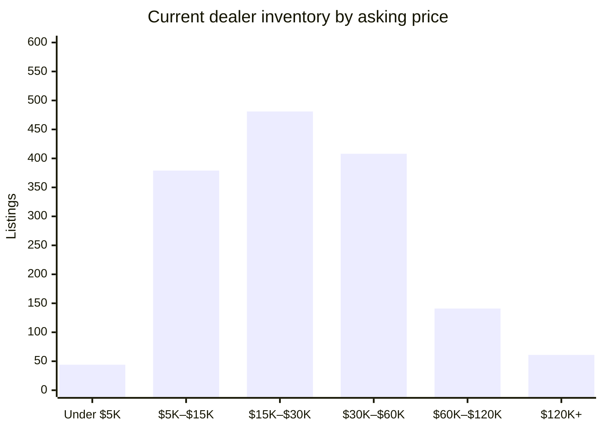

# David Webb Secondary Market — 2026-11-09

## Executive Summary

As of November 9, 2026, the David Webb secondary market reflects a healthy but measured pace: six auction results recorded over the past sixty days carry a median hammer of $31,262, with Sotheby's the sole active house across both Asian and European rooms, topped by a Yellow Sapphire, Diamond and Enamel Demi-Parure that cleared $62,356 in Hong Kong on September 17. Dealer-side activity tells an equally constructive story — 131 listings closed over the past four weeks against just 15 new additions this week, a sell-through dynamic that points to genuine demand absorption rather than supply accumulation. The active dealer pool of 1,579 listings carries a median ask of $24,000, though the week's most significant new entries sit well above that level: a Cabochon Sapphire and Emerald Bracelet fresh from Joseph Saidian and Sons at $175,000 and an Important 18k Gold and Diamond Necklace from Tiina Smith Jewelry at $155,000 both signal that top-tier consignors remain willing to bring important pieces to market at assertive prices. The detailed breakdowns that follow cover current availability, new arrivals, and recent closings in full.

## Currently Available

_1,579 active listings across all tracked dealer marketplaces (estate jewelers, 1stDibs, Sotheby's Buy Now, The RealReal), with a combined asking-price total of $53,377,531. This section is dealer inventory only — there is currently no live, biddable David Webb auction inventory to track; every auction-history record on file is a completed, historical sale (see "Recent Auction Sales" below)._

_That combined total is a sum of current asking prices, not an appraisal or a market valuation — it will run high wherever the same physical piece is listed on more than one platform (see Data-Quality Caveats)._

**By price**

**By category**

| Category | Count | Min | Median | Max |
|---|---|---|---|---|
| Earrings | 475 | $1,900 | $17,800 | $227,500 |
| Ring | 340 | $3,100 | $18,988 | $375,000 |
| Bracelet | 321 | $3,200 | $42,200 | $280,000 |
| Necklace | 214 | $2,796 | $39,150 | $289,500 |
| Brooch | 130 | $3,273 | $25,000 | $114,400 |
| Cufflinks | 26 | $2,250 | $6,050 | $14,800 |
| Other | 8 | $4,800 | $27,000 | $150,000 |

**By dealer**

_15 dealer(s) currently carry David Webb pieces._

| Dealer | Active Listings | Median Asking |
|---|---|---|
| The Back Vault | 961 | $24,000 |
| The RealReal | 115 | $13,496 |
| Oak Gem | 112 | $27,500 |
| Eric Originals & Antiques | 78 | $29,625 |
| Yafa Signed Jewels | 56 | $55,000 |
| Greenleaf & Crosby | 46 | $26,250 |
| Wilson's Estate Jewelry | 36 | $11,025 |
| Saidian & Sons | 31 | $40,000 |
| Sotheby's (Buy Now) | 30 | $18,250 |
| Legacy Vintage Jewels | 16 | $80,000 |
| Macklowe Gallery | 11 | $35,000 |
| Estate Diamond Jewelry | 9 | $15,000 |
| Kentshire | 6 | $36,000 |
| Louis Martin | 4 | $24,500 |
| A. Brandt + Son | 3 | $14,995 |

## Trends by Motif & Material

_Tags are keyword-matched from each piece's own listing text against David Webb's known design vocabulary (Zodiac, animal/creature pieces, fishscale, rock crystal, enamel, carved hardstone, etc.) — a piece can carry several tags. Tags with fewer than 5 matching records are omitted as too thin to be meaningful. Click a tag to see those exact pieces in the live database._

**Auction (sold prices)**

| Tag | Count | Min | Median | Max |
|---|---|---|---|---|
| [Enamel](https://david-webb-new-york.github.io/david-webb-market-agent/?tag=Enamel) | 953 | $719 | $11,018 | $232,000 |
| [Cabochon](https://david-webb-new-york.github.io/david-webb-market-agent/?tag=Cabochon) | 939 | $1,250 | $16,440 | $508,000 |
| [Carved Hardstone](https://david-webb-new-york.github.io/david-webb-market-agent/?tag=Carved%20Hardstone) | 558 | $875 | $15,060 | $693,000 |
| [Hammered Gold](https://david-webb-new-york.github.io/david-webb-market-agent/?tag=Hammered%20Gold) | 428 | $1,250 | $11,420 | $201,600 |
| [Animal/Creature](https://david-webb-new-york.github.io/david-webb-market-agent/?tag=Animal%2FCreature) | 417 | $719 | $12,244 | $218,500 |
| [Cuff/Bangle](https://david-webb-new-york.github.io/david-webb-market-agent/?tag=Cuff%2FBangle) | 363 | $1,314 | $23,750 | $218,500 |
| [Bombé](https://david-webb-new-york.github.io/david-webb-market-agent/?tag=Bomb%C3%A9) | 201 | $1,250 | $12,454 | $1,426,500 |
| [Rock Crystal](https://david-webb-new-york.github.io/david-webb-market-agent/?tag=Rock%20Crystal) | 178 | $954 | $12,858 | $106,250 |
| [Maltese Cross](https://david-webb-new-york.github.io/david-webb-market-agent/?tag=Maltese%20Cross) | 36 | $3,125 | $20,000 | $134,500 |
| [Door Knocker](https://david-webb-new-york.github.io/david-webb-market-agent/?tag=Door%20Knocker) | 29 | $3,125 | $9,525 | $106,250 |
| [Zodiac](https://david-webb-new-york.github.io/david-webb-market-agent/?tag=Zodiac) | 27 | $812 | $8,713 | $90,000 |
| [Shell/Starfish](https://david-webb-new-york.github.io/david-webb-market-agent/?tag=Shell%2FStarfish) | 17 | $1,700 | $5,175 | $146,500 |

**Current dealer inventory (asking prices)**

| Tag | Count | Min | Median | Max |
|---|---|---|---|---|
| [Enamel](https://david-webb-new-york.github.io/david-webb-market-agent/?tag=Enamel) | 496 | $2,796 | $20,700 | $289,500 |
| [Carved Hardstone](https://david-webb-new-york.github.io/david-webb-market-agent/?tag=Carved%20Hardstone) | 286 | $3,850 | $34,400 | $289,500 |
| [Cabochon](https://david-webb-new-york.github.io/david-webb-market-agent/?tag=Cabochon) | 261 | $3,200 | $27,500 | $240,500 |
| [Animal/Creature](https://david-webb-new-york.github.io/david-webb-market-agent/?tag=Animal%2FCreature) | 233 | $3,100 | $21,400 | $280,000 |
| [Hammered Gold](https://david-webb-new-york.github.io/david-webb-market-agent/?tag=Hammered%20Gold) | 176 | $3,056 | $22,500 | $143,000 |
| [Cuff/Bangle](https://david-webb-new-york.github.io/david-webb-market-agent/?tag=Cuff%2FBangle) | 171 | $3,200 | $37,300 | $250,200 |
| [1970s](https://david-webb-new-york.github.io/david-webb-market-agent/?tag=1970s) | 145 | $3,100 | $27,900 | $289,500 |
| [1960s](https://david-webb-new-york.github.io/david-webb-market-agent/?tag=1960s) | 86 | $3,100 | $29,625 | $265,000 |
| [Rock Crystal](https://david-webb-new-york.github.io/david-webb-market-agent/?tag=Rock%20Crystal) | 63 | $4,800 | $37,000 | $225,000 |
| [1980s](https://david-webb-new-york.github.io/david-webb-market-agent/?tag=1980s) | 57 | $4,250 | $22,700 | $81,200 |
| [Bombé](https://david-webb-new-york.github.io/david-webb-market-agent/?tag=Bomb%C3%A9) | 55 | $6,400 | $18,800 | $214,500 |
| [Door Knocker](https://david-webb-new-york.github.io/david-webb-market-agent/?tag=Door%20Knocker) | 48 | $8,713 | $20,750 | $214,500 |
| [Zodiac](https://david-webb-new-york.github.io/david-webb-market-agent/?tag=Zodiac) | 20 | $4,500 | $18,150 | $64,300 |
| [Shell/Starfish](https://david-webb-new-york.github.io/david-webb-market-agent/?tag=Shell%2FStarfish) | 14 | $7,200 | $12,100 | $30,700 |
| [Maltese Cross](https://david-webb-new-york.github.io/david-webb-market-agent/?tag=Maltese%20Cross) | 13 | $27,300 | $35,700 | $65,000 |

## New in the Last Week

_15 dealer listing(s) first seen in the last 7 days, across all sources and price points._

| Piece | Category | Dealer | Price | Date |
|---|---|---|---|---|
| [David Webb Cabochon Sapphire & Emerald Bracelet](https://www.1stdibs.com/jewelry/bracelets/modern-bracelets/david-webb-cabochon-sapphire-emerald-bracelet/id-j_19052912/) | Bracelet | Joseph Saidian and Sons | $175,000 | 2026-11-03 |
| [Important David Webb 18k Gold and Diamond Necklace](https://www.1stdibs.com/jewelry/necklaces/link-necklaces/important-david-webb-18k-gold-diamond-necklace/id-j_31061882/) | Necklace | Tiina Smith Jewelry | $155,000 | 2026-11-03 |
| [David Webb Opal Diamond Ruby Platinum 18 Karat Yellow Gold Fish Cocktail Ring](https://wilsonsestatejewelry.com/products/david-webb-opal-diamond-ruby-platinum-18-karat-yellow-gold-fish-cocktail-ring) | Ring | Wilson's Estate Jewelry | $36,800 | 2026-11-06 |
| [David Webb Onyx Platinum & 18K Yellow Gold Onyx Octagon Open Link Chain Necklace](https://thebackvault.com/products/david-webb-onyx-platinum-18k-yellow-gold-onyx-octagon-open-link-chain-necklace-rr7415) | Necklace | The Back Vault | $29,200 | 2026-11-05 |
| [David Webb Vreeland Diamond Zebra Earrings](https://ericoriginals.com/products/david-webb-vreeland-diamond-zebra-earrings) | Earrings | Eric Originals & Antiques | $26,000 | 2026-11-02 |
| Gold and Diamond Convertible Pendant Brooch | Necklace | Sotheby's (Buy Now) | $25,000 | 2026-11-06 |
| [18K Emerald Tiger Pin Brooch](https://www.therealreal.com/products/jewelry/brooches/pin/david-webb-18k-emerald-tiger-pin-brooch-x6a26) | Brooch | The RealReal | $18,500 | 2026-11-05 |
| Vintage Gold Pendant Brooch | Necklace | Sotheby's (Buy Now) | $16,000 | 2026-11-02 |
| David Webb Gold and Diamond Earclips | Earrings | Sotheby's (Buy Now) | $16,000 | 2026-11-06 |
| [18K Pearl & Diamond Clip-On Earrings](https://www.therealreal.com/products/details/jewelry/earrings/clip-on/david-webb-18k-pearl-diamond-clip-on-earrings-vdo55) | Earrings | The RealReal | $15,500 | 2026-11-09 |
| [David Webb 1980's 18 Karat Yellow Gold Vintage Hammered Fancy Twist Link Bracelet](https://wilsonsestatejewelry.com/products/david-webb-1980s-18-karat-yellow-gold-vintage-hammered-fancy-twist-link-bracelet) | Bracelet | Wilson's Estate Jewelry | $15,200 | 2026-11-04 |
| [18K Hammered Doorknockers Large Oversized Earrings](https://www.therealreal.com/products/jewelry/earrings/clip-on/david-webb-18k-hammered-doorknockers-large-oversized-earrings-wzbgr) | Earrings | The RealReal | $12,995 | 2026-11-09 |
| [18K Alligator Print Clip-on Earrings](https://www.therealreal.com/products/jewelry/earrings/clip-on/david-webb-18k-alligator-print-clip-on-earrings-xdspk) | Earrings | The RealReal | $10,500 | 2026-11-04 |
| [2.96ctw Sapphire & Ruby Cufflinks](https://www.therealreal.com/products/jewelry/cufflinks/david-webb-2-96ctw-sapphire-ruby-cufflinks-x6a1n) | Cufflinks | The RealReal | $4,750 | 2026-11-09 |
| [David Webb Gold Enamel Striped Cufflinks](https://oakgem.com/products/david-webb-gold-enamel-striped-cufflinks) | Cufflinks | Oak Gem | $4,400 | 2026-11-09 |

## Closed / Sold in the Last 4 Weeks

_131 dealer listing(s) delisted in the last 28 days — "closed" usually but not always means sold (see Data-Quality Caveats)._

| Piece | Category | Dealer | Price | Date |
|---|---|---|---|---|
| [Iconic David Webb Necklace](https://www.1stdibs.com/jewelry/necklaces/link-necklaces/iconic-david-webb-necklace/id-j_25653002/) | Necklace | Joseph Saidian and Sons | $345,000 | 2026-08-10 |
| [David Webb Coral Double Lion Head Bangle Bracelet](https://www.1stdibs.com/jewelry/bracelets/bangles/david-webb-coral-double-lion-head-bangle-bracelet/id-j_8543371/) | Bracelet | The Back Vault | $288,000 | 2026-09-14 |
| [David Webb Emerald and Diamond Earrings](https://www.1stdibs.com/jewelry/earrings/chandelier-earrings/david-webb-emerald-diamond-earrings/id-j_25344112/) | Earrings | Joseph Saidian and Sons | $260,000 | 2026-10-30 |
| [David Webb Rock Crystal Necklace](https://www.1stdibs.com/jewelry/necklaces/chain-necklaces/david-webb-rock-crystal-necklace/id-j_24965412/) | Necklace | Legacy Vintage Jewels | $220,000 | 2026-08-10 |
| [David Webb Coral Chimera Bracelet](https://www.1stdibs.com/jewelry/bracelets/bangles/david-webb-coral-chimera-bracelet/id-j_28629522/) | Bracelet | Joseph Saidian and Sons | $185,000 | 2026-09-14 |
| [David Webb Cabochon Sapphire & Emerald Bracelet](https://www.1stdibs.com/jewelry/bracelets/modern-bracelets/david-webb-cabochon-sapphire-emerald-bracelet/id-j_19052912/) | Bracelet | Joseph Saidian and Sons | $175,000 | 2026-11-03 |
| [David Webb Ruby Diamond Bracelet](https://www.1stdibs.com/jewelry/bracelets/retro-bracelets/david-webb-ruby-diamond-bracelet/id-j_20812622/) | Bracelet | ISKENDERIAN | $133,900 | 2026-08-10 |
| [David Webb Turquoise, Ruby, and Diamond Necklace](https://www.1stdibs.com/jewelry/necklaces/beaded-necklaces/david-webb-turquoise-ruby-diamond-necklace/id-j_25225442/) | Necklace | Legacy Vintage Jewels | $110,000 | 2026-08-10 |
| [David Webb Stud Diamond And Black Enamel Necklace](https://www.1stdibs.com/jewelry/necklaces/link-necklaces/david-webb-stud-diamond-black-enamel-necklace/id-j_15259522/) | Necklace | The Back Vault | $109,000 | 2026-10-22 |
| [David Webb Emerald & Diamond Pendent Earrings](https://www.1stdibs.com/jewelry/earrings/dangle-earrings/david-webb-emerald-diamond-pendent-earrings/id-j_24936592/) | Earrings | Legacy Vintage Jewels | $104,000 | 2026-08-10 |
| [David Webb Chestnut Horse Bracelet](https://www.1stdibs.com/jewelry/bracelets/link-bracelets/david-webb-chestnut-horse-bracelet/id-j_29735152/) | Bracelet | Eric Originals and Antiques LTD | $89,700 | 2026-10-30 |
| [David Webb Emerald Diamond Ring](https://www.1stdibs.com/jewelry/rings/engagement-rings/david-webb-emerald-diamond-ring/id-j_26564002/) | Ring | Select Antique Jewelry Inc | $80,000 | 2026-10-02 |
| [David Webb Cocktail Dome Ring](https://www.1stdibs.com/jewelry/rings/dome-rings/david-webb-cocktail-dome-ring/id-j_15334282/) | Ring | Joseph Saidian and Sons | $60,000 | 2026-08-10 |
| [David Webb Jade and Enamel Earrings](https://www.1stdibs.com/jewelry/earrings/clip-on-earrings/david-webb-jade-enamel-earrings/id-j_30079972/) | Earrings | Joseph Saidian and Sons | $60,000 | 2026-10-19 |
| [David Webb Tassel Necklace](https://www.1stdibs.com/jewelry/necklaces/pendant-necklaces/david-webb-tassel-necklace/id-j_29923192/) | Necklace | Joseph Saidian and Sons | $55,000 | 2026-08-10 |
| [David Webb Carved Coral and Diamond Clip Earrings](https://www.1stdibs.com/jewelry/earrings/clip-on-earrings/david-webb-carved-coral-diamond-clip-earrings/id-j_12842542/) | Earrings | The Back Vault | $49,913 | 2026-10-05 |
| [David Webb Coral, Diamond & Emerald Ring](https://www.1stdibs.com/jewelry/rings/cocktail-rings/david-webb-coral-diamond-emerald-ring/id-j_25900962/) | Ring | 66 mint | $47,850 | 2026-08-31 |
| [David Webb Pearl, Diamond, Onyx & Rock Crystal Necklace](https://www.1stdibs.com/jewelry/necklaces/pendant-necklaces/david-webb-pearl-diamond-onyx-rock-crystal-necklace/id-j_29659532/) | Necklace | Odeon Collection | $42,000 | 2026-09-08 |
| [David Webb "Lady Justice" Brooch](https://www.1stdibs.com/jewelry/brooches/brooches/david-webb-lady-justice-brooch/id-j_13409562/) | Brooch | NALLY JEWELS | $39,750 | 2026-10-30 |
| [David Webb Onyx Platinum & 18K Yellow Gold Onyx Octagon Open Link Chain Necklace](https://thebackvault.com/products/david-webb-onyx-platinum-18k-yellow-gold-onyx-octagon-open-link-chain-necklace-rr7415) | Necklace | The Back Vault | $29,200 | 2026-11-05 |
| [David Webb Modernist Coral Ring](https://www.1stdibs.com/jewelry/rings/fashion-rings/david-webb-modernist-coral-ring/id-j_29089142/) | Ring | Lawrence Jeffrey | $21,000 | 2026-08-10 |
| [David Webb Frog Brooch](https://www.1stdibs.com/jewelry/brooches/brooches/david-webb-frog-brooch/id-j_30182982/) | Brooch | Eric Originals and Antiques LTD | $18,970 | 2026-08-17 |
| [David Webb Gem-Set and Diamond Earrings United States, Circa 1970](https://www.1stdibs.com/jewelry/earrings/clip-on-earrings/david-webb-gem-set-diamond-earrings-united-states-circa-1970/id-j_28789232/) | Earrings | Odeon Collection | $18,750 | 2026-09-28 |
| [David Webb Frog Brooch](https://www.1stdibs.com/jewelry/brooches/brooches/david-webb-frog-brooch/id-j_26026232/) | Brooch | Eric Originals and Antiques LTD | $18,000 | 2026-08-17 |
| [David Webb Gold Brooch](https://www.1stdibs.com/jewelry/brooches/brooches/david-webb-gold-brooch/id-j_28836742/) | Brooch | Stella Rubin Jewelry | $12,500 | 2026-09-10 |
| [David Webb Diamond, Ruby and Emerald Earrings](https://www.1stdibs.com/jewelry/earrings/clip-on-earrings/david-webb-diamond-ruby-emerald-earrings/id-j_19506002/) | Earrings | Stella Rubin Jewelry | $12,500 | 2026-09-30 |
| [David Webb Diamond Hoop Earrings](https://www.1stdibs.com/jewelry/earrings/hoop-earrings/david-webb-diamond-hoop-earrings/id-j_29089102/) | Earrings | Lawrence Jeffrey | $9,800 | 2026-08-10 |
| [David Webb Oval Hoop Earrings](https://www.1stdibs.com/jewelry/earrings/lever-back-earrings/david-webb-oval-hoop-earrings/id-j_17350342/) | Earrings | Stella Rubin Jewelry | $9,600 | 2026-08-10 |
| [David Webb Trio of Gemstone Rings](https://www.1stdibs.com/jewelry/rings/fashion-rings/david-webb-trio-gemstone-rings/id-j_17080732/) | Other | Stella Rubin Jewelry | $8,500 | 2026-08-10 |
| [David Webb Gold and Diamonds Ring](https://www.1stdibs.com/jewelry/rings/fashion-rings/david-webb-gold-diamonds-ring/id-j_25886562/) | Ring | Stella Rubin Jewelry | $6,800 | 2026-09-18 |
| [David Webb Large Gold Earrings](https://www.1stdibs.com/jewelry/earrings/clip-on-earrings/david-webb-large-gold-earrings/id-j_29850792/) | Earrings | Stella Rubin Jewelry | $5,200 | 2026-10-02 |
| [David Webb Diamond Zebra Bracelet](https://ericoriginals.com/products/david-webb-diamond-zebra-bracelet) | Bracelet | Eric Originals & Antiques | $335,000 | 2026-08-27 |
| [David Webb Multigem and Diamond Floral Gold Brooch](https://www.1stdibs.com/jewelry/brooches/brooches/david-webb-multigem-diamond-floral-gold-brooch/id-j_29572672/) | Brooch | Legacy Vintage Jewels | $125,000 | 2026-09-03 |
| [Vintage 1960s David Webb Double Headed Frog Bracelet](https://ericoriginals.com/products/vintage-1960s-david-webb-double-headed-frog-bracelet) | Bracelet | Eric Originals & Antiques | $69,850 | 2026-08-07 |
| [David Webb Black Enamel Leopard Brooch with Diamonds and Emeralds](https://ericoriginals.com/products/david-webb-black-enamel-leopard-brooch-with-diamonds-and-emeralds) | Brooch | Eric Originals & Antiques | $45,000 | 2026-08-07 |
| [David Webb Gold Crossover Swirls Cuff Bracelet](https://ericoriginals.com/products/david-webb-gold-crossover-swirls-cuff-bracelet) | Bracelet | Eric Originals & Antiques | $42,500 | 2026-08-07 |
| [David Webb Turquoise Diamond Platinum Wrap Ring](https://www.1stdibs.com/jewelry/rings/cocktail-rings/david-webb-turquoise-diamond-platinum-wrap-ring/id-j_25263882/) | Ring | Select Antique Jewelry Inc | $36,000 | 2026-10-05 |
| [David Webb Vreeland Diamond Zebra Earrings](https://ericoriginals.com/products/david-webb-vreeland-diamond-zebra-earrings) | Earrings | Eric Originals & Antiques | $26,000 | 2026-11-02 |
| [Vintage 1960s David Webb Black Enamel Earrings with Diamonds](https://ericoriginals.com/products/vintage-1960s-david-webb-black-enamel-earrings-with-diamonds) | Earrings | Eric Originals & Antiques | $19,500 | 2026-08-07 |
| [18K Pearl & Diamond Clip-On Earrings](https://www.therealreal.com/products/jewelry/earrings/clip-on/david-webb-18k-pearl-diamond-clip-on-earrings-vdo55) | Earrings | The RealReal | $15,500 | 2026-08-12 |
| Vintage Gold and Diamond Earclips and Convertible Pendant Brooch Set | Necklace | Sotheby's (Buy Now) | $41,000 | 2026-08-10 |
| [David Webb Mount Olympus Turquoise and Diamond Crossover Ring](https://saidiansons.com/products/david-webb-mount-olympus-turquoise-and-diamond-crossover-ring) | Ring | Saidian & Sons | $28,000 | 2026-10-01 |
| [David Webb Three Stone Cabochon and Diamond Earrings](https://www.1stdibs.com/jewelry/earrings/clip-on-earrings/david-webb-three-stone-cabochon-diamond-earrings/id-j_26293322/) | Earrings | Legacy Vintage Jewels | $15,000 | 2026-10-14 |
| [18K Diamond Clip-On Earrings](https://www.therealreal.com/products/details/jewelry/earrings/clip-on/david-webb-18k-diamond-clip-on-earrings-ulz58) | Earrings | The RealReal | $11,500 | 2026-08-12 |
| [David Webb Certified Natural 15 carat Sapphire & Diamond Ring](https://saidiansons.com/products/david-webb-sapphire-and-diamond-ring-1) | Ring | Saidian & Sons | n/a | 2026-08-07 |
| [David Webb Emerald and Diamond Chimera Bangle Bracelet](https://saidiansons.com/products/david-webb-emerald-and-diamond-chimera-bangle-bracelet) | Bracelet | Saidian & Sons | n/a | 2026-08-07 |
| [Important David Webb 18k Gold and Diamond Necklace](https://www.1stdibs.com/jewelry/necklaces/link-necklaces/important-david-webb-18k-gold-diamond-necklace/id-j_31061882/) | Necklace | Tiina Smith Jewelry | $155,000 | 2026-11-03 |
| [David Webb Bird Brooch with Sapphire, Emerald, Ruby, and Diamonds](https://www.1stdibs.com/jewelry/brooches/brooches/david-webb-bird-brooch-sapphire-emerald-ruby-diamonds/id-j_25153132/) | Brooch | Legacy Vintage Jewels | $80,000 | 2026-08-12 |
| [David Webb Carved Jade Diamond and Ruby Seahorse Brooch](https://www.1stdibs.com/jewelry/brooches/brooches/david-webb-carved-jade-diamond-ruby-seahorse-brooch/id-j_29572622/) | Brooch | Legacy Vintage Jewels | $80,000 | 2026-08-18 |
| [David Webb Carved Jade & Diamond Disc Brooch](https://www.1stdibs.com/jewelry/brooches/brooches/david-webb-carved-jade-diamond-disc-brooch/id-j_25550452/) | Brooch | Legacy Vintage Jewels | $30,000 | 2026-08-19 |
| [Vintage 1.57ctw Diamond, Pearl & Ruby Multistrand Choker Necklace](https://www.therealreal.com/products/jewelry/necklaces/choker/david-webb-vintage-1-57ctw-diamond-pearl-ruby-multistrand-choker-necklace-ulokj) | Necklace | The RealReal | $19,995 | 2026-08-12 |
| [David Webb Black Enamel and 18K Yellow Gold Bracelet](https://www.1stdibs.com/jewelry/bracelets/link-bracelets/david-webb-black-enamel-18k-yellow-gold-bracelet/id-j_23210762/) | Bracelet | Charles Schwartz & Son | $17,000 | 2026-08-17 |
| [David Webb 0.50 Carat Round Brilliant Diamond and Striped Enamel Cocktail Ring](https://www.1stdibs.com/jewelry/rings/cocktail-rings/david-webb-050-carat-round-brilliant-diamond-striped-enamel-cocktail-ring/id-j_17092542/) | Ring | Charles Schwartz & Son | $13,500 | 2026-08-17 |
| [David Webb White Enamel, Diamond and Lapis Fish Bracelet In 18k](https://www.1stdibs.com/jewelry/bracelets/cuff-bracelets/david-webb-white-enamel-diamond-lapis-fish-bracelet-18k/id-j_28110872/) | Bracelet | NALLY JEWELS | $79,500 | 2026-10-08 |
| [David Webb Diamond, Coral & White Enamel Frog Brooch](https://www.1stdibs.com/jewelry/brooches/brooches/david-webb-diamond-coral-white-enamel-frog-brooch/id-j_24885662/) | Brooch | NALLY JEWELS | $58,000 | 2026-10-08 |
| [David Webb Pearl Amethyst and Chalcedony Necklace](https://www.1stdibs.com/jewelry/necklaces/multi-strand-necklaces/david-webb-pearl-amethyst-chalcedony-necklace/id-j_25791342/) | Necklace | Joseph Saidian and Sons | $55,000 | 2026-10-26 |
| [David Webb "VIRGO"  Diamond & Gold Brooch/Pendant](https://www.1stdibs.com/jewelry/brooches/brooches/david-webb-virgo-diamond-gold-brooch-pendant/id-j_24196512/) | Necklace | NALLY JEWELS | $32,500 | 2026-10-08 |
| [David Webb Tutti Frutti Earrings](https://www.1stdibs.com/jewelry/earrings/chandelier-earrings/david-webb-tutti-frutti-earrings/id-j_30070212/) | Earrings | Joseph Saidian and Sons | $150,000 | 2026-08-31 |
| [David Webb Rock Crystal Coral and Onyx Necklace](https://saidiansons.com/products/david-webb-rock-crystal-coral-and-onyx-necklace) | Necklace | Saidian & Sons | $100,000 | 2026-08-19 |
| [David Webb 18kt White Gold Coral and Diamond Dome Cocktail Ring, Circa 1970](https://www.1stdibs.com/jewelry/rings/cocktail-rings/david-webb-18kt-white-gold-coral-diamond-dome-cocktail-ring-circa-1970/id-j_28970402/) | Ring | Sperlich Jewelry | $21,118 | 2026-10-30 |
| [David Webb Star Natural Star Sapphire & Diamond Ring](https://www.1stdibs.com/jewelry/rings/cocktail-rings/david-webb-star-natural-star-sapphire-diamond-ring/id-j_24981562/) | Ring | Legacy Vintage Jewels | $20,500 | 2026-08-13 |
| [18K Zigzag Hammered Ring](https://www.therealreal.com/products/jewelry/rings/band/david-webb-18k-zigzag-hammered-ring-wzj6t) | Ring | The RealReal | $8,995 | 2026-10-12 |
| [18K Crescent Clip On Earrings](https://www.therealreal.com/products/details/jewelry/earrings/clip-on/david-webb-18k-crescent-clip-on-earrings-v37f7) | Earrings | The RealReal | $6,495 | 2026-08-12 |
| [David Webb Tutti Frutti Earrings](https://saidiansons.com/products/david-webb-tutti-frutti-earrings) | Earrings | Saidian & Sons | n/a | 2026-08-07 |
| [David Webb Green Enamel, Diamond and Ruby Frog Bracelet](https://www.1stdibs.com/jewelry/bracelets/bangles/david-webb-green-enamel-diamond-ruby-frog-bracelet/id-j_17166932/) | Bracelet | The Back Vault | $68,000 | 2026-10-29 |
| [David Webb Unicorn Black Enamel, Ruby, Diamonds Vintage Brooch](https://www.1stdibs.com/jewelry/brooches/brooches/david-webb-unicorn-black-enamel-ruby-diamonds-vintage-brooch/id-j_10906392/) | Brooch | The Back Vault | $57,750 | 2026-10-29 |
| [David Webb Black Enamel 18 Karat Gold Emerald Eyes Tiger Brooch](https://www.1stdibs.com/jewelry/brooches/brooches/david-webb-black-enamel-18-karat-gold-emerald-eyes-tiger-brooch/id-j_8784561/) | Brooch | The Back Vault | $30,525 | 2026-08-21 |
| [David Webb 18K Yellow Gold Green Enamel Monkey Brooch](https://www.1stdibs.com/jewelry/brooches/brooches/david-webb-18k-yellow-gold-green-enamel-monkey-brooch/id-j_20809362/) | Brooch | The Back Vault | $28,000 | 2026-10-29 |
| [David Webb Kingdom White Enamel Panther With Diamond Collar Vintage Brooch](https://www.1stdibs.com/jewelry/brooches/brooches/david-webb-kingdom-white-enamel-panther-diamond-collar-vintage-brooch/id-j_10905832/) | Necklace | The Back Vault | $25,575 | 2026-10-29 |
| [David Webb Frog Platinum and 18 Karat Gold Green Frog, Enamel, Diamonds Brooch](https://www.1stdibs.com/jewelry/brooches/brooches/david-webb-frog-platinum-18-karat-gold-green-frog-enamel-diamonds-brooch/id-j_11166432/) | Brooch | The Back Vault | $15,675 | 2026-10-29 |
| [David Webb Green Enamel and Gold Frog Pin Brooch Pendant](https://www.1stdibs.com/jewelry/brooches/brooches/david-webb-green-enamel-gold-frog-pin-brooch-pendant/id-j_8303711/) | Necklace | The Back Vault | $14,025 | 2026-10-07 |
| [David Webb 18K Yellow Gold Repousse Hippocuff Bracelet](https://www.1stdibs.com/jewelry/bracelets/cuff-bracelets/david-webb-18k-yellow-gold-repousse-hippocuff-bracelet/id-j_30923072/) | Bracelet | RT Jewelers Inc | $100,000 | 2026-10-20 |
| [David Webb White Enamel 18K Lion Head Cufflinks with Cabochon Emerald Eye](https://www.1stdibs.com/jewelry/cufflinks/cufflinks/david-webb-white-enamel-18k-lion-head-cufflinks-cabochon-emerald-eye/id-j_29732702/) | Cufflinks | Greenwich Bazzar | $13,800 | 2026-08-31 |
| [18K Enamel Radiator Hoop Clip-OnEarrings](https://www.therealreal.com/products/details/jewelry/earrings/clip-on/david-webb-18k-enamel-radiator-hoop-clip-onearrings-vrsbi) | Earrings | The RealReal | $13,750 | 2026-08-12 |
| [18K 9.83ctw Citrine Clip-On Earrings](https://www.therealreal.com/products/jewelry/earrings/clip-on/david-webb-18k-9-83ctw-citrine-clip-on-earrings-wn3gf) | Earrings | The RealReal | $7,275 | 2026-10-12 |
| [Impressive David Webb Diamond Gemstone Gold Platinum Brooch Pendant](https://oakgem.com/products/impressive-david-webb-diamond-gemstone-gold-platinum-brooch-pendant) | Necklace | Oak Gem | $28,000 | 2026-08-07 |
| [Vintage David Webb 18K Black Enamel Link Bracelet](https://www.1stdibs.com/jewelry/bracelets/link-bracelets/vintage-david-webb-18k-black-enamel-link-bracelet/id-j_30055212/) | Bracelet | Jewelry Grove | $25,000 | 2026-09-02 |
| [18K Diamond & Emerald Crossover Leopard Cocktail Ring](https://www.therealreal.com/products/jewelry/rings/cocktail-ring/david-webb-18k-diamond-emerald-crossover-leopard-cocktail-ring-uc4ez) | Ring | The RealReal | $22,096 | 2026-08-12 |
| Vintage Gold and Diamond Bombé Earclips | Earrings | Sotheby's (Buy Now) | $13,500 | 2026-08-10 |
| [18K Ruby, Emerald, & Sapphire Clip-On Earrings](https://www.therealreal.com/products/jewelry/earrings/clip-on/david-webb-18k-ruby-emerald-sapphire-clip-on-earrings-t86nf) | Earrings | The RealReal | $13,496 | 2026-08-12 |
| [Pearl & Diamond Earclip Earrings](https://www.therealreal.com/products/jewelry/earrings/earclip/david-webb-pearl-diamond-earclip-earrings-uc44z) | Earrings | The RealReal | $8,921 | 2026-08-12 |
| [David Webb 18k Gold Enamel Earrings](https://www.1stdibs.com/jewelry/earrings/clip-on-earrings/david-webb-18k-gold-enamel-earrings/id-j_30054762/) | Earrings | Jewelry Grove | $8,000 | 2026-09-02 |
| [David Webb Girandole Carved Emerald And Diamond Dangle Earrings](https://thebackvault.com/products/david-webb-girandole-carved-emerald-and-diamond-dangle-earrings-rr8426) | Earrings | The Back Vault | $149,500 | 2026-08-07 |
| [Vintage Pair of David Webb Baroque Pearl Diamond Pendant Earrings](https://www.1stdibs.com/jewelry/earrings/dangle-earrings/vintage-pair-of-david-webb-baroque-pearl-diamond-pendant-earrings/id-j_30159182/) | Necklace | Keyamour | $58,000 | 2026-08-10 |
| [David Webb Pair of Emerald and Diamond Pendent Ear Clips](https://legacyvintagejewels.com/products/pair-of-emerald-and-diamond-pendent-ear-clips) | Necklace | Legacy Vintage Jewels | $130,000 | 2026-08-07 |
| [David Webb Multigem and Diamond Floral Gold Brooch](https://www.1stdibs.com/jewelry/brooches/brooches/david-webb-multigem-diamond-floral-gold-brooch/id-j_30067222/) | Brooch | Legacy Vintage Jewels | $125,000 | 2026-08-11 |
| [David Webb Carved Emerald and Diamond Ring](https://www.1stdibs.com/jewelry/rings/cocktail-rings/david-webb-carved-emerald-diamond-ring/id-j_27931262/) | Ring | Joseph Saidian and Sons | $95,000 | 2026-10-19 |
| [David Webb Convertible Yellow Gold Chain](https://www.1stdibs.com/jewelry/necklaces/chain-necklaces/david-webb-convertible-yellow-gold-chain/id-j_24467672/) | Necklace | M.S. Rau | $54,500 | 2026-09-04 |
| [David Webb Enamel, 18K & Platinum Tire Ring signed with a David Webb Certificate](https://www.1stdibs.com/jewelry/rings/dome-rings/david-webb-enamel-18k-platinum-tire-ring-signed-david-webb-certificate/id-j_24069042/) | Ring | Pierre/Famille | $22,320 | 2026-08-10 |
| [David Webb Diamond Leaf Earrings](https://www.1stdibs.com/jewelry/earrings/clip-on-earrings/david-webb-diamond-leaf-earrings/id-j_27874372/) | Earrings | Macklowe Gallery Jewelry | $16,500 | 2026-08-17 |
| [David Webb Ruby and Diamond Lion Bangle Bracelet](https://saidiansons.com/products/david-webb-ruby-and-diamond-lion-bangle-bracelet) | Bracelet | Saidian & Sons | n/a | 2026-08-07 |
| [David Webb Rubellite &amp; Turquoise Diamond Necklace & Earrings Set](https://saidiansons.com/products/david-webb-rubellite-amp-turquoise-diamond-necklace-amp-earrings-set) | Necklace | Saidian & Sons | n/a | 2026-08-07 |
| [David Webb Carved Emerald and Diamond Ring](https://saidiansons.com/products/david-webb-carved-emerald-and-diamond-ring-1) | Ring | Saidian & Sons | n/a | 2026-08-07 |
| [David Webb Turquoise Lapis Lazuli Diamond Necklace](https://www.1stdibs.com/jewelry/necklaces/link-necklaces/david-webb-turquoise-lapis-lazuli-diamond-necklace/id-j_26617312/) | Necklace | NALLY JEWELS | $98,000 | 2026-10-22 |
| [David Webb White Enamel, Diamond And Ruby Double Panthere Head Bracelet.](https://www.1stdibs.com/jewelry/bracelets/bangles/david-webb-white-enamel-diamond-ruby-double-panthere-head-bracelet/id-j_29666452/) | Bracelet | NALLY JEWELS | $85,000 | 2026-10-08 |
| [David Webb Amethyst and 18k Hammered Gold Cuff Bracelet](https://www.1stdibs.com/jewelry/bracelets/cuff-bracelets/david-webb-amethyst-18k-hammered-gold-cuff-bracelet/id-j_30234382/) | Bracelet | Tiina Smith Jewelry | $72,000 | 2026-10-05 |
| [David Webb Celtic Crescent Convertible Necklace / Brooch i](https://www.1stdibs.com/jewelry/necklaces/link-necklaces/david-webb-celtic-crescent-convertible-necklace-brooch-i/id-j_29945312/) | Necklace | NALLY JEWELS | $69,500 | 2026-10-08 |
| [David Webb Turquoise Cabochon Link Necklace](https://legacyvintagejewels.com/products/david-webb-turquoise-cabochon-link-necklace) | Necklace | Legacy Vintage Jewels | $50,000 | 2026-10-20 |
| [David Webb Enamel, 18K & Platinum Tire Ring signed with a David Webb Certificate](https://www.1stdibs.com/jewelry/rings/cocktail-rings/david-webb-enamel-18k-platinum-tire-ring-signed-david-webb-certificate/id-j_30112182/) | Ring | Pierre/Famille | $20,720 | 2026-08-13 |
| [18K Sapphire Ram Cocktail Ring](https://www.therealreal.com/products/details/jewelry/rings/cocktail-ring/david-webb-18k-sapphire-ram-cocktail-ring-v9wib) | Ring | The RealReal | $6,800 | 2026-09-22 |
| [David Webb Diamond & 18K Gold Ring](https://www.1stdibs.com/jewelry/rings/engagement-rings/david-webb-diamond-18k-gold-ring/id-j_27945582/) | Ring | 66 mint | $17,500 | 2026-08-10 |
| [18K 2.91ctw Diamond Enamel Bangle Bracelet](https://www.therealreal.com/products/details/jewelry/bracelets/bangle/david-webb-18k-2-91ctw-diamond-enamel-bangle-bracelet-trkec) | Bracelet | The RealReal | $15,597 | 2026-08-12 |
| [David Webb Multi Row Diamond Stud Earrings in 18 Karat Yellow Gold and Platinum](https://www.1stdibs.com/jewelry/earrings/stud-earrings/david-webb-multi-row-diamond-stud-earrings-18-karat-yellow-gold-platinum/id-j_27044782/) | Earrings | Secret Jewelry Source | $14,125 | 2026-10-21 |
| [18K Enamel Wolf Stud Earrings](https://www.therealreal.com/products/jewelry/earrings/stud/david-webb-18k-enamel-wolf-stud-earrings-ubdoc) | Earrings | The RealReal | $6,157 | 2026-08-12 |
| [David Webb Green-Blue Enamel Emerald Diamond Pendant Brooch](https://www.1stdibs.com/jewelry/brooches/brooches/david-webb-green-blue-enamel-emerald-diamond-pendant-brooch/id-j_23451002/) | Necklace | Greenleaf & Crosby | $39,500 | 2026-09-07 |
| [David Webb Zebra Ring, Diamond and Enamel 18K Yellow Gold Platinum](https://www.1stdibs.com/jewelry/rings/cocktail-rings/david-webb-zebra-ring-diamond-enamel-18k-yellow-gold-platinum/id-j_28437452/) | Ring | Aryamehr Fine Jewelry | $19,300 | 2026-08-10 |
| [David Webb Lapis Link Yellow Gold Necklace](https://oakgem.com/products/david-webb-lapis-link-yellow-gold-necklace) | Necklace | Oak Gem | $18,000 | 2026-08-07 |
| [Vintage David Webb Enamel 18K Yellow Gold Statement Ring](https://www.1stdibs.com/jewelry/rings/cocktail-rings/vintage-david-webb-enamel-18k-yellow-gold-statement-ring/id-j_29898252/) | Ring | Antinori di Sanpietro | $15,600 | 2026-09-21 |
| [David Webb Black Enamel Pyramid Trellis Dome Earrings](https://www.1stdibs.com/jewelry/earrings/clip-on-earrings/david-webb-black-enamel-pyramid-trellis-dome-earrings/id-j_16698822/) | Earrings | Greenleaf & Crosby | $11,600 | 2026-09-21 |
| [David Webb 1970s 18K Gold Enamel Leaf Dome Statement Ring](https://www.1stdibs.com/jewelry/rings/cocktail-rings/david-webb-1970s-18k-gold-enamel-leaf-dome-statement-ring/id-j_25360572/) | Ring | Dover Jewelry | $11,700 | 2026-08-13 |
| [David Webb Cabochon Emerald and Diamond Bracelet](https://ericoriginals.com/products/david-webb-cabochon-emerald-and-diamond-bracelet) | Bracelet | Eric Originals & Antiques | $410,000 | 2026-08-07 |
| [18K Twisted Link Bracelet](https://www.therealreal.com/products/jewelry/bracelets/link/david-webb-18k-twisted-link-bracelet-vdsys) | Bracelet | The RealReal | $35,500 | 2026-08-12 |
| [Diamond Hinged Cuff Bracelet](https://www.therealreal.com/products/jewelry/bracelets/bangle/david-webb-diamond-hinged-cuff-bracelet-vysvr) | Bracelet | The RealReal | $28,495 | 2026-08-28 |
| [Vintage David Webb 18K Gold Black Enamel and Diamond Earrings](https://www.1stdibs.com/jewelry/earrings/clip-on-earrings/vintage-david-webb-18k-gold-black-enamel-diamond-earrings/id-j_27375042/) | Earrings | Benchmark of Palm Beach | $19,750 | 2026-10-16 |
| [Vintage David Webb Yellow Gold, Platinum, Diamond, Enamel & South Sea Pearl Ring](https://www.1stdibs.com/jewelry/rings/cocktail-rings/vintage-david-webb-yellow-gold-platinum-diamond-enamel-south-sea-pearl-ring/id-j_29395322/) | Ring | Benchmark of Palm Beach | $15,500 | 2026-10-16 |
| [Vintage David Webb 18K Yellow Gold Bamboo Motif White Enamel Large Scale Ring](https://www.1stdibs.com/jewelry/rings/cocktail-rings/vintage-david-webb-18k-yellow-gold-bamboo-motif-white-enamel-large-scale-ring/id-j_26265432/) | Ring | Benchmark of Palm Beach | $15,500 | 2026-10-16 |
| [Vintage David Webb Leopard Ring in 18K Yellow Gold and Enamel](https://www.1stdibs.com/jewelry/rings/cocktail-rings/vintage-david-webb-leopard-ring-18k-yellow-gold-enamel/id-j_22730542/) | Ring | Benchmark of Palm Beach | $14,500 | 2026-10-16 |
| [David Webb Ruby and Enamel Frog Pin in 18K Yellow Gold](https://www.1stdibs.com/jewelry/brooches/brooches/david-webb-ruby-enamel-frog-pin-18k-yellow-gold/id-j_23891282/) | Brooch | Skibell Fine Jewelry | $13,200 | 2026-08-10 |
| [David Webb 18K Yellow Gold Bold Hammered Scroll Motif Earrings](https://www.1stdibs.com/jewelry/earrings/clip-on-earrings/david-webb-18k-yellow-gold-bold-hammered-scroll-motif-earrings/id-j_18270272/) | Earrings | Benchmark of Palm Beach | $12,750 | 2026-10-16 |
| [Unusual and Outstanding David Webb 18K Gold and Black Enamel Hoop Earrings](https://www.1stdibs.com/jewelry/earrings/hoop-earrings/unusual-outstanding-david-webb-18k-gold-black-enamel-hoop-earrings/id-j_20154212/) | Earrings | Benchmark of Palm Beach | $9,500 | 2026-10-16 |
| [David Webb Carved Topaz and Black Enamel Earrings](https://www.1stdibs.com/jewelry/earrings/clip-on-earrings/david-webb-carved-topaz-black-enamel-earrings/id-j_8517041/) | Earrings | Skibell Fine Jewelry | $8,800 | 2026-08-10 |
| [David Webb Carved Jade and Ruby Cufflinks](https://www.1stdibs.com/jewelry/cufflinks/cufflinks/david-webb-carved-jade-ruby-cufflinks/id-j_10808282/) | Cufflinks | Joseph Saidian and Sons | $7,500 | 2026-10-14 |
| [David Webb Emerald Bangle Bracelet](https://www.1stdibs.com/jewelry/bracelets/bangles/david-webb-emerald-bangle-bracelet/id-j_29923222/) | Bracelet | Joseph Saidian and Sons | $125,000 | 2026-09-07 |
| [David Webb Platinum & 18K Yellow Gold Dinner Roll Necklace](https://thebackvault.com/products/david-webb-platinum-18k-yellow-gold-dinner-roll-necklace-rr8521) | Necklace | The Back Vault | $84,500 | 2026-08-07 |
| [David Webb 1980's Diamond 18 Karat Yellow Gold Platinum Vintage Pavé Station Necklace](https://wilsonsestatejewelry.com/products/david-webb-1980s-diamond-18-karat-yellow-gold-platinum-vintage-pave-station-necklace) | Necklace | Wilson's Estate Jewelry | $48,800 | 2026-08-07 |
| [David Webb Platinum & 18K Yellow Gold Soft Cushion Shaped Pearl And Diamond Earrings](https://thebackvault.com/products/david-webb-platinum-18k-yellow-gold-soft-cushion-shaped-pearl-and-diamond-earrings-rr7061) | Earrings | The Back Vault | $16,500 | 2026-08-07 |
| [David Webb Kingdom Platinum & 18K Yellow Gold Green Enamel Frog Brooch](https://thebackvault.com/products/david-webb-kingdom-platinum-18k-yellow-gold-green-enamel-frog-brooch-rr5151) | Brooch | The Back Vault | $15,700 | 2026-08-07 |
| [David Webb Enamel, 18K & Platinum Tire Ring signed with a David Webb Certificate](https://www.1stdibs.com/jewelry/rings/dome-rings/david-webb-enamel-18k-platinum-tire-ring-signed-david-webb-certificate/id-j_30111972/) | Ring | Pierre/Famille | $27,900 | 2026-09-29 |
| [Vintage 1960s David Webb Swirl Brooch](https://www.1stdibs.com/jewelry/brooches/brooches/vintage-1960s-david-webb-swirl-brooch/id-j_26675002/) | Brooch | Eric Originals and Antiques LTD | $12,250 | 2026-09-28 |
| [Platinum & 18kt Yellow Gold Diamond Pig Ring by David Webb](https://www.1stdibs.com/jewelry/rings/fashion-rings/platinum-18kt-yellow-gold-diamond-pig-ring-david-webb/id-j_17177362/) | Ring | Bernardo Antichita' | $11,968 | 2026-10-02 |
| [18K Hammered Small Swirl Earrings](https://www.therealreal.com/products/jewelry/earrings/clip-on/david-webb-18k-hammered-small-swirl-earrings-tyr7l) | Earrings | The RealReal | $4,871 | 2026-08-12 |

## Recent Auction Sales (Past 60 Days)

_6 completed sale(s) in the last 60 days, median hammer $31,262. These are historical results, not current inventory — see "Currently Available" above._

| Piece | House | Sale Date | Price |
|---|---|---|---|
| Enamel and ruby Brooch, Pair of Earrings and Bracelet | Sotheby's | 2026-10-28 | $38,705 (orig. EUR 33,280) |
| Enamel and Diamond Pendant/ Brooch and Necklace | Sotheby's | 2026-10-28 | $32,750 (orig. EUR 28,160) |
| Yellow Gold and Rock Crystal Demi Parure | Sotheby's | 2026-10-28 | $29,773 (orig. EUR 25,600) |
| Enamel and Ruby Cuff - Bracelet | Sotheby's | 2026-10-28 | $19,352 (orig. EUR 16,640) |
| Gold, Chrysoberyl and Enamel Ring | K金 配 金綠寶石 及 琺瑯彩 戒指 | Sotheby's | 2026-09-23 | $12,307 (orig. HKD 96,000) |
| Yellow Sapphire, Diamond and Enamel Demi-Parure | 黃色剛玉 配 鑽石 及 琺琅彩 項鏈 及 耳夾套装 | Sotheby's | 2026-09-17 | $62,356 (orig. HKD 486,400) |

## All-Time Notable Sales

These benchmark results provide context for current dealer asking prices and collector expectations:

| Piece | House | Date | Hammer |
|---|---|---|---|
| [THE ANNENBERG DIAMOND AN EXCEPTIONAL DIAMOND RING, BY DAVID WEBB](https://www.christies.com/en/lot/lot-5250229) | Christie's | 2009-10-21 | $7,698,500 |
| [A DIAMOND RING, BY DAVID WEBB](https://www.christies.com/en/lot/lot-5578141) | Christie's | 2012-06-12 | $1,874,500 |
| [A COLORED DIAMOND RING, BY DAVID WEBB](https://www.christies.com/en/lot/lot-5578014) | Christie's | 2012-06-12 | $1,426,500 |
| [A PAIR OF NATURAL PEARL AND DIAMOND EAR PENDANTS, BY DAVID WEBB](https://www.christies.com/en/lot/lot-5754780) | Christie's | 2013-12-10 | $1,265,000 |
| [A SAPPHIRE AND DIAMOND BRACELET, BY DAVID WEBB](https://www.christies.com/en/lot/lot-5442124) | Christie's | 2011-05-31 | $959,356 (orig. HKD 7,460,000) |

## Worth a Second Look

_Implausibly low price for the category — a heuristic signal for a human to check, not a fraud determination. A flagged piece may well be genuine; this just surfaces things worth a closer look before relying on the listing. Click through to validate each one. (371 total, showing the 10 cheapest.)_

- [Pair of Gold Necklace Shorteners, David Webb](https://www.doyle.com/auction/lot/lot-142---pair-of-gold-necklace-shorteners-david-webb/?lot=1044120&so=4&st=david webb&sto=0&au=&ef=&et=&ic=False&sd=1&mc=409&mc=9&mc=4&mc=25&mc=167&mc=5&mc=173&mc=410&mc=554&mc=3&mc=209&mc=31&mc=219&mc=188&mc=325&mc=190&mc=146&pp=96&pn=11&g=1) — $375 via Doyle. $375 is well below the typical range for "necklace" (611 comparable auction records, median $17,920).
- [Gold Leaf Brooch, David Webb](https://www.doyle.com/auction/lot/lot-534---gold-leaf-brooch-david-webb/?lot=1020224&so=4&st=david webb&sto=0&au=&ef=&et=&ic=False&sd=1&mc=409&mc=9&mc=4&mc=25&mc=167&mc=5&mc=173&mc=410&mc=554&mc=3&mc=209&mc=31&mc=219&mc=188&mc=325&mc=190&mc=146&pp=96&pn=12&g=1) — $562 via Doyle. $562 is well below the typical range for "brooch" (390 comparable auction records, median $10,713).
- [A GOLD AND DIAMOND PENDANT, BY DAVID WEBB](https://www.christies.com/en/lot/lot-3830577) — $587 via Christie's. $587 is well below the typical range for "necklace" (611 comparable auction records, median $17,920).
- [A David Webb ring modelled as a leopard's head and tail, with black enamel spots and gem set eyes, signed.](https://www.christies.com/en/lot/lot-711892) — $719 (GBP 460) via Christie's. $719 is well below the typical range for "ring" (537 comparable auction records, median $8,320).
- [A Sagittarius brooch by David Webb](https://www.christies.com/en/lot/lot-2533639) — $812 (GBP 564) via Christie's. $812 is well below the typical range for "brooch" (390 comparable auction records, median $10,713).
- [A MUTLISTRAND CULTURED PEARL AND DIAMOND BRACELET, DAVID WEBB](https://www.christies.com/en/lot/lot-1862648) — $822 via Christie's. $822 is well below the typical range for "bracelet" (646 comparable auction records, median $22,590).
- [[BOOKS-JEWELRY] Group of approximately...](https://www.doyle.com/auction/lot/lot-814---books-jewelry-group-of-approximately/?lot=1277810&so=4&st=david webb&sto=0&au=&ef=&et=&ic=False&sd=1&mc=409&mc=9&mc=4&mc=25&mc=167&mc=5&mc=173&mc=410&mc=554&mc=3&mc=209&mc=31&mc=219&mc=188&mc=325&mc=190&mc=146&pp=96&pn=4&g=1) — $875 via Doyle. $875 is well below the typical range for "other" (299 comparable auction records, median $14,886).
- [Gold Jabot, David Webb](https://www.doyle.com/auction/lot/lot-323---gold-jabot-david-webb/?lot=1181319&so=4&st=david webb&sto=0&au=&ef=&et=&ic=False&sd=1&mc=409&mc=9&mc=4&mc=25&mc=167&mc=5&mc=173&mc=410&mc=554&mc=3&mc=209&mc=31&mc=219&mc=188&mc=325&mc=190&mc=146&pp=96&pn=8&g=1) — $875 via Doyle. $875 is well below the typical range for "other" (299 comparable auction records, median $14,886).
- [Gold and Jade Ring, David Webb](https://www.doyle.com/auction/lot/lot-519---gold-and-jade-ring-david-webb/?lot=1076359&so=4&st=david webb&sto=0&au=&ef=&et=&ic=False&sd=1&mc=409&mc=9&mc=4&mc=25&mc=167&mc=5&mc=173&mc=410&mc=554&mc=3&mc=209&mc=31&mc=219&mc=188&mc=325&mc=190&mc=146&pp=96&pn=11&g=1) — $875 via Doyle. $875 is well below the typical range for "ring" (537 comparable auction records, median $8,320).
- [Two Gold and Enamel Jabots, David Webb](https://www.doyle.com/auction/lot/lot-488---two-gold-and-enamel-jabots-david-webb/?lot=1071094&so=4&st=david webb&sto=0&au=&ef=&et=&ic=False&sd=1&mc=409&mc=9&mc=4&mc=25&mc=167&mc=5&mc=173&mc=410&mc=554&mc=3&mc=209&mc=31&mc=219&mc=188&mc=325&mc=190&mc=146&pp=96&pn=11&g=1) — $875 via Doyle. $875 is well below the typical range for "other" (299 comparable auction records, median $14,886).

## Data-Quality Caveats

- **Auction hammer prices exclude buyer's premium** — typically +15–26% depending on the house.
- **Dealer asking prices are not confirmed sale prices** — they're the dealer's current ask, which may be negotiated down or never sell.
- **"Closed" (dealer status: inactive) usually but not always means sold** — could also be a price relist under a new SKU or a data-feed gap.
- **"Currently available" is dealer inventory only.** There is no live, biddable David Webb auction inventory being tracked right now — genuine upcoming auction lots were confirmed absent at the major houses as of the last investigation.
- **A piece can be listed on more than one platform** (e.g. a dealer's own site and 1stDibs) — "total listings" and the combined asking-price total above count platform presence, not unique physical pieces. A 2026-08-12 audit had Claude visually compare the actual photos for every plausible cross-dealer duplicate candidate in the full active dataset (164 candidates, narrowed by price/category/title similarity) and confirmed 4 genuine duplicates (0.55% of active inventory) — each backed by a specific matching physical detail (a fracture pattern, a wear mark, an enamel-link arrangement), not just style similarity. Critically, **none** of the 395 listings from dealers other than The Back Vault/The RealReal were confirmed as also posted to either of those two — so there's no evidence every dealer is double-posting there. (An earlier same-night pass using Google reverse-image search over-flagged several pairs as duplicates that were actually distinct pieces of the same signature David Webb design — Google's "visual match" is a style-similarity tool, not a duplicate detector; the Claude-vision check applied a stricter, physical-identity bar.) This is a lower bound — only candidates the price/title filter surfaced were checked, so a duplicate priced or titled very differently across platforms, or on an untracked dealer, wouldn't be caught.
- **Foreign-currency prices are converted to USD** using approximate historical annual-average exchange rates, not settlement-date-precise figures — the original native-currency amount is footnoted wherever it differs from the displayed USD figure.

