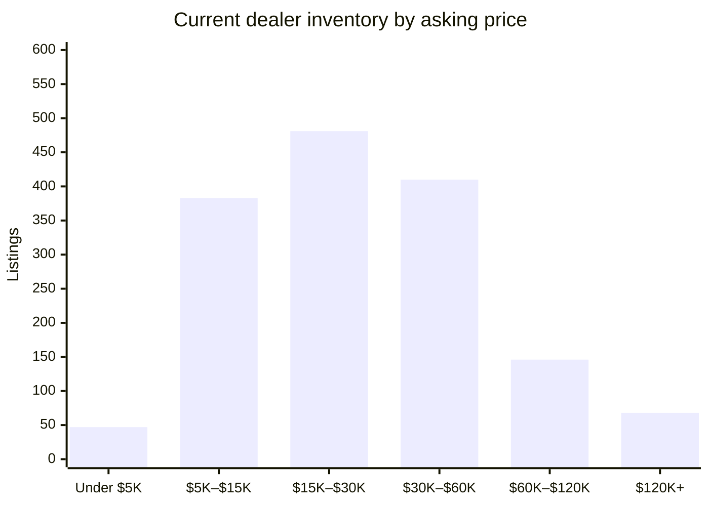

# David Webb Secondary Market — 2026-11-24

## Executive Summary

As of November 24, 2026, the David Webb secondary market presents a picture of measured, deliberate activity rather than broad momentum: 1,601 dealer listings remain active, 12 fresh pieces entered the market over the past week, and a brisk 99 listings closed in the preceding four weeks, pointing to real absorption at current price levels. The dealer asking median sits at $24,000, while the most recent auction cycle — four lots sold at Sotheby's on October 28 — posted a median hammer of $31,262, a premium that underscores continued collector willingness to pay up at auction for the right material. Supply quality at the high end is evident this week: the 20.00-carat Diamond Cluster Earrings freshly listed by Eric Originals and Antiques LTD at $213,000 stand well apart from the broader inventory, while Sotheby's enamel-and-ruby suite realizing $38,705 against a EUR estimate confirms sustained European demand for Webb's signature polychrome work. The detailed breakdowns that follow capture the full current-inventory picture, new arrivals, and closed listings in tabular form.

## Currently Available

_1,601 active listings across all tracked dealer marketplaces (estate jewelers, 1stDibs, Sotheby's Buy Now, The RealReal), with a combined asking-price total of $55,471,472. This section is dealer inventory only — there is currently no live, biddable David Webb auction inventory to track; every auction-history record on file is a completed, historical sale (see "Recent Auction Sales" below)._

_That combined total is a sum of current asking prices, not an appraisal or a market valuation — it will run high wherever the same physical piece is listed on more than one platform (see Data-Quality Caveats)._

**By price**

**By category**

| Category | Count | Min | Median | Max |
|---|---|---|---|---|
| Earrings | 480 | $1,900 | $17,800 | $260,000 |
| Ring | 346 | $3,100 | $19,100 | $375,000 |
| Bracelet | 328 | $3,200 | $42,600 | $288,000 |
| Necklace | 216 | $3,500 | $40,125 | $345,000 |
| Brooch | 131 | $3,273 | $25,000 | $114,400 |
| Cufflinks | 27 | $2,250 | $5,500 | $14,800 |
| Other | 7 | $8,500 | $37,500 | $150,000 |

**By dealer**

_23 dealer(s) currently carry David Webb pieces — showing the top 20 by listing count, the rest bucketed into "Other" below._

| Dealer | Active Listings | Median Asking |
|---|---|---|
| The Back Vault | 963 | $24,000 |
| The RealReal | 120 | $12,871 |
| Oak Gem | 113 | $27,000 |
| Eric Originals & Antiques | 80 | $29,625 |
| Yafa Signed Jewels | 56 | $55,000 |
| Greenleaf & Crosby | 46 | $26,250 |
| Wilson's Estate Jewelry | 36 | $11,025 |
| Saidian & Sons | 32 | $40,000 |
| Sotheby's (Buy Now) | 21 | $16,500 |
| Legacy Vintage Jewels | 17 | $80,000 |
| Macklowe Gallery | 11 | $35,000 |
| Estate Diamond Jewelry | 9 | $15,000 |
| Joseph Saidian and Sons | 8 | $150,000 |
| Kentshire | 6 | $36,000 |
| Louis Martin | 4 | $24,500 |
| A. Brandt + Son | 3 | $14,995 |
| Lawrence Jeffrey | 2 | $15,400 |
| Eric Originals and Antiques LTD | 2 | $17,050 |
| Stella Rubin Jewelry | 2 | $9,050 |
| ISKENDERIAN | 1 | $133,900 |
| Other (3 additional dealers) | 3 | $47,850 |

## Trends by Motif & Material

_Tags are keyword-matched from each piece's own listing text against David Webb's known design vocabulary (Zodiac, animal/creature pieces, fishscale, rock crystal, enamel, carved hardstone, etc.) — a piece can carry several tags. Tags with fewer than 5 matching records are omitted as too thin to be meaningful. Click a tag to see those exact pieces in the live database._

**Auction (sold prices)**

| Tag | Count | Min | Median | Max |
|---|---|---|---|---|
| [Enamel](https://david-webb-new-york.github.io/david-webb-market-agent/?tag=Enamel) | 953 | $719 | $11,018 | $232,000 |
| [Cabochon](https://david-webb-new-york.github.io/david-webb-market-agent/?tag=Cabochon) | 939 | $1,250 | $16,440 | $508,000 |
| [Carved Hardstone](https://david-webb-new-york.github.io/david-webb-market-agent/?tag=Carved%20Hardstone) | 557 | $875 | $15,000 | $693,000 |
| [Hammered Gold](https://david-webb-new-york.github.io/david-webb-market-agent/?tag=Hammered%20Gold) | 428 | $1,250 | $11,420 | $201,600 |
| [Animal/Creature](https://david-webb-new-york.github.io/david-webb-market-agent/?tag=Animal%2FCreature) | 417 | $719 | $12,244 | $218,500 |
| [Cuff/Bangle](https://david-webb-new-york.github.io/david-webb-market-agent/?tag=Cuff%2FBangle) | 364 | $1,314 | $23,750 | $218,500 |
| [Bombé](https://david-webb-new-york.github.io/david-webb-market-agent/?tag=Bomb%C3%A9) | 201 | $1,250 | $12,454 | $1,426,500 |
| [Rock Crystal](https://david-webb-new-york.github.io/david-webb-market-agent/?tag=Rock%20Crystal) | 178 | $954 | $12,858 | $106,250 |
| [Maltese Cross](https://david-webb-new-york.github.io/david-webb-market-agent/?tag=Maltese%20Cross) | 36 | $3,125 | $20,000 | $134,500 |
| [Door Knocker](https://david-webb-new-york.github.io/david-webb-market-agent/?tag=Door%20Knocker) | 29 | $3,125 | $9,525 | $106,250 |
| [Zodiac](https://david-webb-new-york.github.io/david-webb-market-agent/?tag=Zodiac) | 27 | $812 | $8,713 | $90,000 |
| [Shell/Starfish](https://david-webb-new-york.github.io/david-webb-market-agent/?tag=Shell%2FStarfish) | 17 | $1,700 | $5,175 | $146,500 |

**Current dealer inventory (asking prices)**

| Tag | Count | Min | Median | Max |
|---|---|---|---|---|
| [Enamel](https://david-webb-new-york.github.io/david-webb-market-agent/?tag=Enamel) | 494 | $2,900 | $20,700 | $289,500 |
| [Carved Hardstone](https://david-webb-new-york.github.io/david-webb-market-agent/?tag=Carved%20Hardstone) | 291 | $3,850 | $34,400 | $289,500 |
| [Cabochon](https://david-webb-new-york.github.io/david-webb-market-agent/?tag=Cabochon) | 261 | $3,200 | $27,500 | $240,500 |
| [Animal/Creature](https://david-webb-new-york.github.io/david-webb-market-agent/?tag=Animal%2FCreature) | 234 | $3,100 | $21,050 | $288,000 |
| [Hammered Gold](https://david-webb-new-york.github.io/david-webb-market-agent/?tag=Hammered%20Gold) | 179 | $2,696 | $22,500 | $143,000 |
| [Cuff/Bangle](https://david-webb-new-york.github.io/david-webb-market-agent/?tag=Cuff%2FBangle) | 174 | $3,200 | $37,500 | $288,000 |
| [1970s](https://david-webb-new-york.github.io/david-webb-market-agent/?tag=1970s) | 147 | $3,100 | $27,900 | $289,500 |
| [1960s](https://david-webb-new-york.github.io/david-webb-market-agent/?tag=1960s) | 86 | $3,100 | $29,625 | $265,000 |
| [Rock Crystal](https://david-webb-new-york.github.io/david-webb-market-agent/?tag=Rock%20Crystal) | 64 | $4,800 | $38,000 | $225,000 |
| [1980s](https://david-webb-new-york.github.io/david-webb-market-agent/?tag=1980s) | 57 | $4,250 | $22,700 | $81,200 |
| [Bombé](https://david-webb-new-york.github.io/david-webb-market-agent/?tag=Bomb%C3%A9) | 55 | $6,400 | $18,800 | $214,500 |
| [Door Knocker](https://david-webb-new-york.github.io/david-webb-market-agent/?tag=Door%20Knocker) | 49 | $7,688 | $20,800 | $214,500 |
| [Zodiac](https://david-webb-new-york.github.io/david-webb-market-agent/?tag=Zodiac) | 19 | $4,500 | $17,800 | $64,300 |
| [Maltese Cross](https://david-webb-new-york.github.io/david-webb-market-agent/?tag=Maltese%20Cross) | 13 | $27,300 | $35,700 | $65,000 |
| [Shell/Starfish](https://david-webb-new-york.github.io/david-webb-market-agent/?tag=Shell%2FStarfish) | 13 | $5,900 | $10,700 | $30,700 |

## New in the Last Week

_12 dealer listing(s) first seen in the last 7 days, across all sources and price points._

| Piece | Category | Dealer | Price | Date |
|---|---|---|---|---|
| [David Webb 20.00 Carat Diamond Cluster Earrings](https://www.1stdibs.com/jewelry/earrings/drop-earrings/david-webb-2000-carat-diamond-cluster-earrings/id-j_29735012/) | Earrings | Eric Originals and Antiques LTD | $213,000 | 2026-11-17 |
| [David Webb Colombian Emerald & Diamond Men's Ring](https://www.1stdibs.com/jewelry/rings/band-rings/david-webb-colombian-emerald-diamond-mens-ring/id-j_20095252/) | Ring | Joseph Saidian and Sons | $65,000 | 2026-11-17 |
| [18K Emerald Repoussé Alligator Cuff](https://www.therealreal.com/products/jewelry/bracelets/cuff/david-webb-18k-emerald-repousse-alligator-cuff-xdsrq) | Bracelet | The RealReal | $35,000 | 2026-11-19 |
| [18K Emerald Repoussé Alligator Cuff](https://www.therealreal.com/products/details/jewelry/bracelets/cuff/david-webb-18k-emerald-repousse-alligator-cuff-xdsrq) | Bracelet | The RealReal | $35,000 | 2026-11-24 |
| [David Webb Doorknocker Black Onyx Earrings](https://ericoriginals.com/products/david-webb-doorknocker-black-onyx-earrings) | Earrings | Eric Originals & Antiques | $26,000 | 2026-11-20 |
| [David Webb 18 Karat Yellow Gold and Pearl Three Zero Ear Clips](https://www.1stdibs.com/jewelry/earrings/drop-earrings/david-webb-18-karat-yellow-gold-pearl-three-zero-ear-clips/id-j_31011972/) | Earrings | Tiina Smith Jewelry | $22,000 | 2026-11-20 |
| [David Webb Arabesque Gold Drop Earrings](https://oakgem.com/products/david-webb-arabesque-gold-drop-earrings) | Earrings | Oak Gem | $19,000 | 2026-11-20 |
| [3.12ctw Diamond Loop Clip On Earrings](https://www.therealreal.com/products/details/jewelry/earrings/clip-on/david-webb-3-12ctw-diamond-loop-clip-on-earrings-x6mr0) | Earrings | The RealReal | $15,995 | 2026-11-18 |
| [18K Bent Nail Link Bracelet](https://www.therealreal.com/products/details/jewelry/bracelets/link/david-webb-18k-bent-nail-link-bracelet-xg9vr) | Bracelet | The RealReal | $14,750 | 2026-11-17 |
| [David Webb 18 Karat Yellow Gold and Red Enamel Cufflinks](https://www.1stdibs.com/jewelry/cufflinks/cufflinks/david-webb-18-karat-yellow-gold-red-enamel-cufflinks/id-j_30886542/) | Cufflinks | Tiina Smith Jewelry | $7,500 | 2026-11-20 |
| [18K Diamond Infinity Ring](https://www.therealreal.com/products/jewelry/rings/cocktail-ring/david-webb-18k-diamond-infinity-ring-xd93q) | Ring | The RealReal | $3,995 | 2026-11-19 |
| [18K Diamond & Enamel Clip-On earrings](https://www.therealreal.com/products/details/jewelry/earrings/clip-on/david-webb-18k-diamond-enamel-clip-on-earrings-rm3b1) | Earrings | The RealReal | $3,048 | 2026-11-24 |

## Closed / Sold in the Last 4 Weeks

_99 dealer listing(s) delisted in the last 28 days — "closed" usually but not always means sold (see Data-Quality Caveats)._

| Piece | Category | Dealer | Price | Date |
|---|---|---|---|---|
| [David Webb 20.00 Carat Diamond Cluster Earrings](https://www.1stdibs.com/jewelry/earrings/drop-earrings/david-webb-2000-carat-diamond-cluster-earrings/id-j_29735012/) | Earrings | Eric Originals and Antiques LTD | $213,000 | 2026-11-17 |
| [Important David Webb 18k Gold and Diamond Necklace](https://www.1stdibs.com/jewelry/necklaces/link-necklaces/important-david-webb-18k-gold-diamond-necklace/id-j_31061882/) | Necklace | Tiina Smith Jewelry | $155,000 | 2026-11-03 |
| [David Webb Emerald Diamond Ring](https://www.1stdibs.com/jewelry/rings/engagement-rings/david-webb-emerald-diamond-ring/id-j_26564002/) | Ring | Select Antique Jewelry Inc | $80,000 | 2026-10-02 |
| [David Webb Amethyst and 18k Hammered Gold Cuff Bracelet](https://www.1stdibs.com/jewelry/bracelets/cuff-bracelets/david-webb-amethyst-18k-hammered-gold-cuff-bracelet/id-j_30234382/) | Bracelet | Tiina Smith Jewelry | $72,000 | 2026-10-05 |
| [Vintage Pair of David Webb Baroque Pearl Diamond Pendant Earrings](https://www.1stdibs.com/jewelry/earrings/dangle-earrings/vintage-pair-of-david-webb-baroque-pearl-diamond-pendant-earrings/id-j_30159182/) | Necklace | Keyamour | $58,000 | 2026-08-10 |
| [David Webb Diamond and White Enamel Slice Cuff](https://www.1stdibs.com/jewelry/bracelets/cuff-bracelets/david-webb-diamond-white-enamel-slice-cuff/id-j_30506802/) | Bracelet | Tiina Smith Jewelry | $55,000 | 2026-10-05 |
| [David Webb Panthere Platinum & 18K White Gold 19.27 cttw Diamond Brooch](https://thebackvault.com/products/david-webb-panthere-platinum-18k-white-gold-19-27-cttw-diamond-brooch-rr4040) | Necklace | The Back Vault | $50,000 | 2026-08-07 |
| Vintage Gold, Platinum and Diamond Pisces Zodiac Convertible Pendant Brooch | Necklace | Sotheby's (Buy Now) | $27,000 | 2026-08-10 |
| [David Webb 18 Karat Yellow Gold and Pearl Three Zero Ear Clips](https://www.1stdibs.com/jewelry/earrings/drop-earrings/david-webb-18-karat-yellow-gold-pearl-three-zero-ear-clips/id-j_31011972/) | Earrings | Tiina Smith Jewelry | $22,000 | 2026-11-20 |
| Gold, Platinum, Coral and Diamond Ring | Ring | Sotheby's (Buy Now) | $18,000 | 2026-08-10 |
| Platinum, Gold, Enamel and Diamond Earclips | Earrings | Sotheby's (Buy Now) | $12,000 | 2026-08-10 |
| [David Webb 18 Karat Yellow Gold and Red Enamel Cufflinks](https://www.1stdibs.com/jewelry/cufflinks/cufflinks/david-webb-18-karat-yellow-gold-red-enamel-cufflinks/id-j_30886542/) | Cufflinks | Tiina Smith Jewelry | $7,500 | 2026-11-20 |
| [David Webb Large Gold Earrings](https://www.1stdibs.com/jewelry/earrings/clip-on-earrings/david-webb-large-gold-earrings/id-j_29850792/) | Earrings | Stella Rubin Jewelry | $5,200 | 2026-10-02 |
| [David Webb Pearl Amethyst and Chalcedony Necklace](https://www.1stdibs.com/jewelry/necklaces/multi-strand-necklaces/david-webb-pearl-amethyst-chalcedony-necklace/id-j_25791342/) | Necklace | Joseph Saidian and Sons | $55,000 | 2026-10-26 |
| [18K Emerald Repoussé Alligator Cuff](https://www.therealreal.com/products/jewelry/bracelets/cuff/david-webb-18k-emerald-repousse-alligator-cuff-xdsrq) | Bracelet | The RealReal | $35,000 | 2026-11-19 |
| Vintage Gold Nautilus Shell Earclips | Earrings | Sotheby's (Buy Now) | $22,000 | 2026-08-10 |
| Gold Concentric Earclips | Earrings | Sotheby's (Buy Now) | $19,000 | 2026-08-21 |
| Gold Swirl Earclips | Earrings | Sotheby's (Buy Now) | $18,000 | 2026-08-10 |
| Gold, Platinum, Enamel and Diamond Ring | Ring | Sotheby's (Buy Now) | $16,000 | 2026-08-26 |
| [18K Pearl & Diamond Clip-On Earrings](https://www.therealreal.com/products/details/jewelry/earrings/clip-on/david-webb-18k-pearl-diamond-clip-on-earrings-vdo55) | Earrings | The RealReal | $15,500 | 2026-11-09 |
| Platinum Topped Gold, Diamond and Enamel Earclips | Earrings | Sotheby's (Buy Now) | $13,000 | 2026-08-10 |
| [2.75ctw Diamond Band](https://www.therealreal.com/products/jewelry/rings/band/david-webb-2-75ctw-diamond-band-v4e86) | Other | The RealReal | $8,550 | 2026-09-09 |
| [18K Sapphire Ram Cocktail Ring](https://www.therealreal.com/products/jewelry/rings/cocktail-ring/david-webb-18k-sapphire-ram-cocktail-ring-v9wib) | Ring | The RealReal | $5,950 | 2026-08-12 |
| [18K Diamond & Enamel Clip-On earrings](https://www.therealreal.com/products/jewelry/earrings/clip-on/david-webb-18k-diamond-enamel-clip-on-earrings-rm3b1) | Earrings | The RealReal | $3,048 | 2026-08-12 |
| [David Webb Multigem and Diamond Floral Gold Brooch](https://www.1stdibs.com/jewelry/brooches/brooches/david-webb-multigem-diamond-floral-gold-brooch/id-j_29572672/) | Brooch | Legacy Vintage Jewels | $125,000 | 2026-09-03 |
| [David Webb Turquoise, Ruby, and Diamond Necklace](https://www.1stdibs.com/jewelry/necklaces/beaded-necklaces/david-webb-turquoise-ruby-diamond-necklace/id-j_25225442/) | Necklace | Legacy Vintage Jewels | $110,000 | 2026-08-10 |
| [David Webb Bird Brooch with Sapphire, Emerald, Ruby, and Diamonds](https://www.1stdibs.com/jewelry/brooches/brooches/david-webb-bird-brooch-sapphire-emerald-ruby-diamonds/id-j_25153132/) | Brooch | Legacy Vintage Jewels | $80,000 | 2026-08-12 |
| [David Webb Carved Jade Diamond and Ruby Seahorse Brooch](https://www.1stdibs.com/jewelry/brooches/brooches/david-webb-carved-jade-diamond-ruby-seahorse-brooch/id-j_29572622/) | Brooch | Legacy Vintage Jewels | $80,000 | 2026-08-18 |
| [David Webb Pearl, Sapphire and Diamond Bracelet](https://www.1stdibs.com/jewelry/bracelets/beaded-bracelets/david-webb-pearl-sapphire-diamond-bracelet/id-j_30377002/) | Bracelet | Joseph Saidian and Sons | $65,000 | 2026-11-16 |
| [David Webb Emerald & Diamond Ring](https://www.1stdibs.com/jewelry/rings/cocktail-rings/david-webb-emerald-diamond-ring/id-j_24963432/) | Ring | Legacy Vintage Jewels | $40,000 | 2026-08-25 |
| [Liberty Head "Coin" & 1.60ctw Diamond & Pendant Necklace](https://www.therealreal.com/products/jewelry/necklaces/pendant-necklace/david-webb-liberty-head-coin-1-60ctw-diamond-pendant-necklace-u3j88) | Necklace | The RealReal | $30,000 | 2026-08-12 |
| [David Webb Carved Jade & Diamond Disc Brooch](https://www.1stdibs.com/jewelry/brooches/brooches/david-webb-carved-jade-diamond-disc-brooch/id-j_25550452/) | Brooch | Legacy Vintage Jewels | $30,000 | 2026-08-19 |
| [18K Coral & Amethyst Clip-On Earrings](https://www.therealreal.com/products/jewelry/earrings/clip-on/david-webb-18k-coral-amethyst-clip-on-earrings-u3j7b) | Earrings | The RealReal | $20,625 | 2026-08-12 |
| [David Webb Star Natural Star Sapphire & Diamond Ring](https://www.1stdibs.com/jewelry/rings/cocktail-rings/david-webb-star-natural-star-sapphire-diamond-ring/id-j_24981562/) | Ring | Legacy Vintage Jewels | $20,500 | 2026-08-13 |
| [David Webb Three Stone Cabochon and Diamond Earrings](https://www.1stdibs.com/jewelry/earrings/clip-on-earrings/david-webb-three-stone-cabochon-diamond-earrings/id-j_26293322/) | Earrings | Legacy Vintage Jewels | $15,000 | 2026-10-14 |
| [David Webb 18k Gold & Platinum Turquoise and Diamond Clip-On Earrings](https://legacyvintagejewels.com/products/david-webb-18k-gold-platinum-turquoise-and-diamond-clip-on-earrings) | Earrings | Legacy Vintage Jewels | $55,000 | 2026-09-09 |
| [David Webb Repoussé Gold Lion Cuff Bracelet](https://oakgem.com/products/david-webb-repousse-gold-lion-cuff-bracelet) | Bracelet | Oak Gem | $36,000 | 2026-11-13 |
| [David Webb Diamond Leaf Earrings](https://www.1stdibs.com/jewelry/earrings/clip-on-earrings/david-webb-diamond-leaf-earrings/id-j_27874372/) | Earrings | Macklowe Gallery Jewelry | $16,500 | 2026-08-17 |
| [David Webb Chestnut Horse Bracelet](https://www.1stdibs.com/jewelry/bracelets/link-bracelets/david-webb-chestnut-horse-bracelet/id-j_29735152/) | Bracelet | Eric Originals and Antiques LTD | $89,700 | 2026-10-30 |
| [David Webb Frog Brooch](https://www.1stdibs.com/jewelry/brooches/brooches/david-webb-frog-brooch/id-j_30182982/) | Brooch | Eric Originals and Antiques LTD | $18,970 | 2026-08-17 |
| [18K Diamond & Enamel Skip Pendant Necklace](https://www.therealreal.com/products/details/jewelry/necklaces/pendant-necklace/david-webb-18k-diamond-enamel-skip-pendant-necklace-s11bh) | Necklace | The RealReal | $2,796 | 2026-08-25 |
| [David Webb Oval Cut Sapphire Men's Ring](https://legacyvintagejewels.com/products/david-webb-oval-cut-sapphire-mens-ring) | Ring | Legacy Vintage Jewels | $200,000 | 2026-10-20 |
| [18K Ruby, Emerald & Sapphire Clip-On Earrings](https://www.therealreal.com/products/details/jewelry/earrings/clip-on/david-webb-18k-ruby-emerald-sapphire-clip-on-earrings-sbzw8) | Earrings | The RealReal | $7,697 | 2026-08-18 |
| [1.84ctw Emerald & Diamond Pipe Ring](https://www.therealreal.com/products/details/jewelry/rings/band/david-webb-1-84ctw-emerald-diamond-pipe-ring-vrdne) | Ring | The RealReal | $6,495 | 2026-08-12 |
| [18K Enamel Band](https://www.therealreal.com/products/details/jewelry/rings/band/david-webb-18k-enamel-band-ubuzf) | Other | The RealReal | $4,800 | 2026-08-17 |
| [David Webb Platinum & 18K Yellow Gold Dappled White Enamel Diamond Horse Bracelet](https://thebackvault.com/products/david-webb-platinum-18k-yellow-gold-dappled-white-enamel-diamond-horse-bracelet-rr8524) | Bracelet | The Back Vault | $63,000 | 2026-08-07 |
| [18K Diamond Hinged Cuff Bracelet](https://www.therealreal.com/products/jewelry/bracelets/cuff/david-webb-18k-diamond-hinged-cuff-bracelet-sqi66) | Bracelet | The RealReal | $32,500 | 2026-08-12 |
| Gold, Amethyst and Diamond Ring | Ring | Sotheby's (Buy Now) | $18,875 | 2026-08-10 |
| Gold, Diamond and White Enamel Ring | Ring | Sotheby's (Buy Now) | $18,500 | 2026-08-10 |
| [18K Quartz & Diamond Clip-on Earrings](https://www.therealreal.com/products/jewelry/earrings/clip-on/david-webb-18k-quartz-diamond-clip-on-earrings-x0f33) | Earrings | The RealReal | $15,795 | 2026-10-19 |
| [Vintage 18K Diamond Convertible Clip-On Earrings](https://www.therealreal.com/products/jewelry/earrings/clip-on/david-webb-vintage-18k-diamond-convertible-clip-on-earrings-ubue4) | Earrings | The RealReal | $18,995 | 2026-08-12 |
| [David Webb Jade and Enamel Earrings](https://www.1stdibs.com/jewelry/earrings/clip-on-earrings/david-webb-jade-enamel-earrings/id-j_30079972/) | Earrings | Joseph Saidian and Sons | $60,000 | 2026-10-19 |
| [David Webb Pearl, Diamond, Onyx & Rock Crystal Necklace](https://www.1stdibs.com/jewelry/necklaces/pendant-necklaces/david-webb-pearl-diamond-onyx-rock-crystal-necklace/id-j_29659532/) | Necklace | Odeon Collection | $42,000 | 2026-09-08 |
| [David Webb "Lady Justice" Brooch](https://www.1stdibs.com/jewelry/brooches/brooches/david-webb-lady-justice-brooch/id-j_13409562/) | Brooch | NALLY JEWELS | $39,750 | 2026-10-30 |
| [David Webb Onyx Platinum & 18K Yellow Gold Onyx Octagon Open Link Chain Necklace](https://thebackvault.com/products/david-webb-onyx-platinum-18k-yellow-gold-onyx-octagon-open-link-chain-necklace-rr7415) | Necklace | The Back Vault | $29,200 | 2026-11-05 |
| [David Webb Gem-Set and Diamond Earrings United States, Circa 1970](https://www.1stdibs.com/jewelry/earrings/clip-on-earrings/david-webb-gem-set-diamond-earrings-united-states-circa-1970/id-j_28789232/) | Earrings | Odeon Collection | $18,750 | 2026-09-28 |
| [David Webb Gold Brooch](https://www.1stdibs.com/jewelry/brooches/brooches/david-webb-gold-brooch/id-j_28836742/) | Brooch | Stella Rubin Jewelry | $12,500 | 2026-09-10 |
| [David Webb Diamond, Ruby and Emerald Earrings](https://www.1stdibs.com/jewelry/earrings/clip-on-earrings/david-webb-diamond-ruby-emerald-earrings/id-j_19506002/) | Earrings | Stella Rubin Jewelry | $12,500 | 2026-09-30 |
| [David Webb Gold and Diamonds Ring](https://www.1stdibs.com/jewelry/rings/fashion-rings/david-webb-gold-diamonds-ring/id-j_25886562/) | Ring | Stella Rubin Jewelry | $6,800 | 2026-09-18 |
| [David Webb Diamond Zebra Bracelet](https://ericoriginals.com/products/david-webb-diamond-zebra-bracelet) | Bracelet | Eric Originals & Antiques | $335,000 | 2026-08-27 |
| [Vintage 1960s David Webb Double Headed Frog Bracelet](https://ericoriginals.com/products/vintage-1960s-david-webb-double-headed-frog-bracelet) | Bracelet | Eric Originals & Antiques | $69,850 | 2026-08-07 |
| [David Webb Black Enamel Leopard Brooch with Diamonds and Emeralds](https://ericoriginals.com/products/david-webb-black-enamel-leopard-brooch-with-diamonds-and-emeralds) | Brooch | Eric Originals & Antiques | $45,000 | 2026-08-07 |
| [David Webb Gold Crossover Swirls Cuff Bracelet](https://ericoriginals.com/products/david-webb-gold-crossover-swirls-cuff-bracelet) | Bracelet | Eric Originals & Antiques | $42,500 | 2026-08-07 |
| [David Webb Vreeland Diamond Zebra Earrings](https://ericoriginals.com/products/david-webb-vreeland-diamond-zebra-earrings) | Earrings | Eric Originals & Antiques | $26,000 | 2026-11-02 |
| [Vintage 1960s David Webb Black Enamel Earrings with Diamonds](https://ericoriginals.com/products/vintage-1960s-david-webb-black-enamel-earrings-with-diamonds) | Earrings | Eric Originals & Antiques | $19,500 | 2026-08-07 |
| [18K Pearl & Diamond Clip-On Earrings](https://www.therealreal.com/products/jewelry/earrings/clip-on/david-webb-18k-pearl-diamond-clip-on-earrings-vdo55) | Earrings | The RealReal | $15,500 | 2026-08-12 |
| Vintage Gold and Diamond Earclips and Convertible Pendant Brooch Set | Necklace | Sotheby's (Buy Now) | $41,000 | 2026-08-10 |
| [David Webb Mount Olympus Turquoise and Diamond Crossover Ring](https://saidiansons.com/products/david-webb-mount-olympus-turquoise-and-diamond-crossover-ring) | Ring | Saidian & Sons | $28,000 | 2026-10-01 |
| [18K Diamond Clip-On Earrings](https://www.therealreal.com/products/details/jewelry/earrings/clip-on/david-webb-18k-diamond-clip-on-earrings-ulz58) | Earrings | The RealReal | $11,500 | 2026-08-12 |
| [David Webb Emerald and Diamond Chimera Bangle Bracelet](https://saidiansons.com/products/david-webb-emerald-and-diamond-chimera-bangle-bracelet) | Bracelet | Saidian & Sons | n/a | 2026-08-07 |
| [Vintage 1.57ctw Diamond, Pearl & Ruby Multistrand Choker Necklace](https://www.therealreal.com/products/jewelry/necklaces/choker/david-webb-vintage-1-57ctw-diamond-pearl-ruby-multistrand-choker-necklace-ulokj) | Necklace | The RealReal | $19,995 | 2026-08-12 |
| [David Webb Black Enamel and 18K Yellow Gold Bracelet](https://www.1stdibs.com/jewelry/bracelets/link-bracelets/david-webb-black-enamel-18k-yellow-gold-bracelet/id-j_23210762/) | Bracelet | Charles Schwartz & Son | $17,000 | 2026-08-17 |
| [David Webb 0.50 Carat Round Brilliant Diamond and Striped Enamel Cocktail Ring](https://www.1stdibs.com/jewelry/rings/cocktail-rings/david-webb-050-carat-round-brilliant-diamond-striped-enamel-cocktail-ring/id-j_17092542/) | Ring | Charles Schwartz & Son | $13,500 | 2026-08-17 |
| [David Webb White Enamel, Diamond and Lapis Fish Bracelet In 18k](https://www.1stdibs.com/jewelry/bracelets/cuff-bracelets/david-webb-white-enamel-diamond-lapis-fish-bracelet-18k/id-j_28110872/) | Bracelet | NALLY JEWELS | $79,500 | 2026-10-08 |
| [David Webb Diamond, Coral & White Enamel Frog Brooch](https://www.1stdibs.com/jewelry/brooches/brooches/david-webb-diamond-coral-white-enamel-frog-brooch/id-j_24885662/) | Brooch | NALLY JEWELS | $58,000 | 2026-10-08 |
| [David Webb "VIRGO"  Diamond & Gold Brooch/Pendant](https://www.1stdibs.com/jewelry/brooches/brooches/david-webb-virgo-diamond-gold-brooch-pendant/id-j_24196512/) | Necklace | NALLY JEWELS | $32,500 | 2026-10-08 |
| [David Webb Tutti Frutti Earrings](https://www.1stdibs.com/jewelry/earrings/chandelier-earrings/david-webb-tutti-frutti-earrings/id-j_30070212/) | Earrings | Joseph Saidian and Sons | $150,000 | 2026-08-31 |
| [David Webb Rock Crystal Coral and Onyx Necklace](https://saidiansons.com/products/david-webb-rock-crystal-coral-and-onyx-necklace) | Necklace | Saidian & Sons | $100,000 | 2026-08-19 |
| [David Webb 18kt White Gold Coral and Diamond Dome Cocktail Ring, Circa 1970](https://www.1stdibs.com/jewelry/rings/cocktail-rings/david-webb-18kt-white-gold-coral-diamond-dome-cocktail-ring-circa-1970/id-j_28970402/) | Ring | Sperlich Jewelry | $21,118 | 2026-10-30 |
| [18K Crescent Clip On Earrings](https://www.therealreal.com/products/details/jewelry/earrings/clip-on/david-webb-18k-crescent-clip-on-earrings-v37f7) | Earrings | The RealReal | $6,495 | 2026-08-12 |
| [David Webb Tutti Frutti Earrings](https://saidiansons.com/products/david-webb-tutti-frutti-earrings) | Earrings | Saidian & Sons | n/a | 2026-08-07 |
| [David Webb Green Enamel, Diamond and Ruby Frog Bracelet](https://www.1stdibs.com/jewelry/bracelets/bangles/david-webb-green-enamel-diamond-ruby-frog-bracelet/id-j_17166932/) | Bracelet | The Back Vault | $68,000 | 2026-10-29 |
| [David Webb Unicorn Black Enamel, Ruby, Diamonds Vintage Brooch](https://www.1stdibs.com/jewelry/brooches/brooches/david-webb-unicorn-black-enamel-ruby-diamonds-vintage-brooch/id-j_10906392/) | Brooch | The Back Vault | $57,750 | 2026-10-29 |
| [David Webb Black Enamel 18 Karat Gold Emerald Eyes Tiger Brooch](https://www.1stdibs.com/jewelry/brooches/brooches/david-webb-black-enamel-18-karat-gold-emerald-eyes-tiger-brooch/id-j_8784561/) | Brooch | The Back Vault | $30,525 | 2026-08-21 |
| [David Webb 18K Yellow Gold Green Enamel Monkey Brooch](https://www.1stdibs.com/jewelry/brooches/brooches/david-webb-18k-yellow-gold-green-enamel-monkey-brooch/id-j_20809362/) | Brooch | The Back Vault | $28,000 | 2026-10-29 |
| [David Webb Kingdom White Enamel Panther With Diamond Collar Vintage Brooch](https://www.1stdibs.com/jewelry/brooches/brooches/david-webb-kingdom-white-enamel-panther-diamond-collar-vintage-brooch/id-j_10905832/) | Necklace | The Back Vault | $25,575 | 2026-10-29 |
| [David Webb Frog Platinum and 18 Karat Gold Green Frog, Enamel, Diamonds Brooch](https://www.1stdibs.com/jewelry/brooches/brooches/david-webb-frog-platinum-18-karat-gold-green-frog-enamel-diamonds-brooch/id-j_11166432/) | Brooch | The Back Vault | $15,675 | 2026-10-29 |
| [David Webb Green Enamel and Gold Frog Pin Brooch Pendant](https://www.1stdibs.com/jewelry/brooches/brooches/david-webb-green-enamel-gold-frog-pin-brooch-pendant/id-j_8303711/) | Necklace | The Back Vault | $14,025 | 2026-10-07 |
| [David Webb 18K Yellow Gold Repousse Hippocuff Bracelet](https://www.1stdibs.com/jewelry/bracelets/cuff-bracelets/david-webb-18k-yellow-gold-repousse-hippocuff-bracelet/id-j_30923072/) | Bracelet | RT Jewelers Inc | $100,000 | 2026-10-20 |
| [David Webb White Enamel 18K Lion Head Cufflinks with Cabochon Emerald Eye](https://www.1stdibs.com/jewelry/cufflinks/cufflinks/david-webb-white-enamel-18k-lion-head-cufflinks-cabochon-emerald-eye/id-j_29732702/) | Cufflinks | Greenwich Bazzar | $13,800 | 2026-08-31 |
| [18K Enamel Radiator Hoop Clip-OnEarrings](https://www.therealreal.com/products/details/jewelry/earrings/clip-on/david-webb-18k-enamel-radiator-hoop-clip-onearrings-vrsbi) | Earrings | The RealReal | $13,750 | 2026-08-12 |
| [18K 9.83ctw Citrine Clip-On Earrings](https://www.therealreal.com/products/jewelry/earrings/clip-on/david-webb-18k-9-83ctw-citrine-clip-on-earrings-wn3gf) | Earrings | The RealReal | $7,275 | 2026-10-12 |
| [Impressive David Webb Diamond Gemstone Gold Platinum Brooch Pendant](https://oakgem.com/products/impressive-david-webb-diamond-gemstone-gold-platinum-brooch-pendant) | Necklace | Oak Gem | $28,000 | 2026-08-07 |
| [Vintage David Webb 18K Black Enamel Link Bracelet](https://www.1stdibs.com/jewelry/bracelets/link-bracelets/vintage-david-webb-18k-black-enamel-link-bracelet/id-j_30055212/) | Bracelet | Jewelry Grove | $25,000 | 2026-09-02 |
| [18K Diamond & Emerald Crossover Leopard Cocktail Ring](https://www.therealreal.com/products/jewelry/rings/cocktail-ring/david-webb-18k-diamond-emerald-crossover-leopard-cocktail-ring-uc4ez) | Ring | The RealReal | $22,096 | 2026-08-12 |
| Vintage Gold and Diamond Bombé Earclips | Earrings | Sotheby's (Buy Now) | $13,500 | 2026-08-10 |
| [18K Ruby, Emerald, & Sapphire Clip-On Earrings](https://www.therealreal.com/products/jewelry/earrings/clip-on/david-webb-18k-ruby-emerald-sapphire-clip-on-earrings-t86nf) | Earrings | The RealReal | $13,496 | 2026-08-12 |
| [Pearl & Diamond Earclip Earrings](https://www.therealreal.com/products/jewelry/earrings/earclip/david-webb-pearl-diamond-earclip-earrings-uc44z) | Earrings | The RealReal | $8,921 | 2026-08-12 |
| [David Webb 18k Gold Enamel Earrings](https://www.1stdibs.com/jewelry/earrings/clip-on-earrings/david-webb-18k-gold-enamel-earrings/id-j_30054762/) | Earrings | Jewelry Grove | $8,000 | 2026-09-02 |

## Recent Auction Sales (Past 60 Days)

_4 completed sale(s) in the last 60 days, median hammer $31,262. These are historical results, not current inventory — see "Currently Available" above._

| Piece | House | Sale Date | Price |
|---|---|---|---|
| Enamel and ruby Brooch, Pair of Earrings and Bracelet | Sotheby's | 2026-10-28 | $38,705 (orig. EUR 33,280) |
| Enamel and Diamond Pendant/ Brooch and Necklace | Sotheby's | 2026-10-28 | $32,750 (orig. EUR 28,160) |
| Yellow Gold and Rock Crystal Demi Parure | Sotheby's | 2026-10-28 | $29,773 (orig. EUR 25,600) |
| Enamel and Ruby Cuff - Bracelet | Sotheby's | 2026-10-28 | $19,352 (orig. EUR 16,640) |

## All-Time Notable Sales

These benchmark results provide context for current dealer asking prices and collector expectations:

| Piece | House | Date | Hammer |
|---|---|---|---|
| [THE ANNENBERG DIAMOND AN EXCEPTIONAL DIAMOND RING, BY DAVID WEBB](https://www.christies.com/en/lot/lot-5250229) | Christie's | 2009-10-21 | $7,698,500 |
| [A DIAMOND RING, BY DAVID WEBB](https://www.christies.com/en/lot/lot-5578141) | Christie's | 2012-06-12 | $1,874,500 |
| [A COLORED DIAMOND RING, BY DAVID WEBB](https://www.christies.com/en/lot/lot-5578014) | Christie's | 2012-06-12 | $1,426,500 |
| [A PAIR OF NATURAL PEARL AND DIAMOND EAR PENDANTS, BY DAVID WEBB](https://www.christies.com/en/lot/lot-5754780) | Christie's | 2013-12-10 | $1,265,000 |
| [A SAPPHIRE AND DIAMOND BRACELET, BY DAVID WEBB](https://www.christies.com/en/lot/lot-5442124) | Christie's | 2011-05-31 | $959,356 (orig. HKD 7,460,000) |

## Worth a Second Look

_Implausibly low price for the category — a heuristic signal for a human to check, not a fraud determination. A flagged piece may well be genuine; this just surfaces things worth a closer look before relying on the listing. Click through to validate each one. (372 total, showing the 10 cheapest.)_

- [Pair of Gold Necklace Shorteners, David Webb](https://www.doyle.com/auction/lot/lot-142---pair-of-gold-necklace-shorteners-david-webb/?lot=1044120&so=4&st=david webb&sto=0&au=&ef=&et=&ic=False&sd=1&mc=409&mc=9&mc=4&mc=25&mc=167&mc=5&mc=173&mc=410&mc=554&mc=3&mc=209&mc=31&mc=219&mc=188&mc=325&mc=190&mc=146&pp=96&pn=11&g=1) — $375 via Doyle. $375 is well below the typical range for "necklace" (611 comparable auction records, median $17,920).
- [Gold Leaf Brooch, David Webb](https://www.doyle.com/auction/lot/lot-534---gold-leaf-brooch-david-webb/?lot=1020224&so=4&st=david webb&sto=0&au=&ef=&et=&ic=False&sd=1&mc=409&mc=9&mc=4&mc=25&mc=167&mc=5&mc=173&mc=410&mc=554&mc=3&mc=209&mc=31&mc=219&mc=188&mc=325&mc=190&mc=146&pp=96&pn=12&g=1) — $562 via Doyle. $562 is well below the typical range for "brooch" (390 comparable auction records, median $10,713).
- [A GOLD AND DIAMOND PENDANT, BY DAVID WEBB](https://www.christies.com/en/lot/lot-3830577) — $587 via Christie's. $587 is well below the typical range for "necklace" (611 comparable auction records, median $17,920).
- [A David Webb ring modelled as a leopard's head and tail, with black enamel spots and gem set eyes, signed.](https://www.christies.com/en/lot/lot-711892) — $719 (GBP 460) via Christie's. $719 is well below the typical range for "ring" (537 comparable auction records, median $8,320).
- [A Sagittarius brooch by David Webb](https://www.christies.com/en/lot/lot-2533639) — $812 (GBP 564) via Christie's. $812 is well below the typical range for "brooch" (390 comparable auction records, median $10,713).
- [A MUTLISTRAND CULTURED PEARL AND DIAMOND BRACELET, DAVID WEBB](https://www.christies.com/en/lot/lot-1862648) — $822 via Christie's. $822 is well below the typical range for "bracelet" (647 comparable auction records, median $22,680).
- [[BOOKS-JEWELRY] Group of approximately...](https://www.doyle.com/auction/lot/lot-814---books-jewelry-group-of-approximately/?lot=1277810&so=4&st=david webb&sto=0&au=&ef=&et=&ic=False&sd=1&mc=409&mc=9&mc=4&mc=25&mc=167&mc=5&mc=173&mc=410&mc=554&mc=3&mc=209&mc=31&mc=219&mc=188&mc=325&mc=190&mc=146&pp=96&pn=4&g=1) — $875 via Doyle. $875 is well below the typical range for "other" (299 comparable auction records, median $14,886).
- [Gold Jabot, David Webb](https://www.doyle.com/auction/lot/lot-323---gold-jabot-david-webb/?lot=1181319&so=4&st=david webb&sto=0&au=&ef=&et=&ic=False&sd=1&mc=409&mc=9&mc=4&mc=25&mc=167&mc=5&mc=173&mc=410&mc=554&mc=3&mc=209&mc=31&mc=219&mc=188&mc=325&mc=190&mc=146&pp=96&pn=8&g=1) — $875 via Doyle. $875 is well below the typical range for "other" (299 comparable auction records, median $14,886).
- [Gold and Jade Ring, David Webb](https://www.doyle.com/auction/lot/lot-519---gold-and-jade-ring-david-webb/?lot=1076359&so=4&st=david webb&sto=0&au=&ef=&et=&ic=False&sd=1&mc=409&mc=9&mc=4&mc=25&mc=167&mc=5&mc=173&mc=410&mc=554&mc=3&mc=209&mc=31&mc=219&mc=188&mc=325&mc=190&mc=146&pp=96&pn=11&g=1) — $875 via Doyle. $875 is well below the typical range for "ring" (537 comparable auction records, median $8,320).
- [Two Gold and Enamel Jabots, David Webb](https://www.doyle.com/auction/lot/lot-488---two-gold-and-enamel-jabots-david-webb/?lot=1071094&so=4&st=david webb&sto=0&au=&ef=&et=&ic=False&sd=1&mc=409&mc=9&mc=4&mc=25&mc=167&mc=5&mc=173&mc=410&mc=554&mc=3&mc=209&mc=31&mc=219&mc=188&mc=325&mc=190&mc=146&pp=96&pn=11&g=1) — $875 via Doyle. $875 is well below the typical range for "other" (299 comparable auction records, median $14,886).

## Data-Quality Caveats

- **Auction hammer prices exclude buyer's premium** — typically +15–26% depending on the house.
- **Dealer asking prices are not confirmed sale prices** — they're the dealer's current ask, which may be negotiated down or never sell.
- **"Closed" (dealer status: inactive) usually but not always means sold** — could also be a price relist under a new SKU or a data-feed gap.
- **"Currently available" is dealer inventory only.** There is no live, biddable David Webb auction inventory being tracked right now — genuine upcoming auction lots were confirmed absent at the major houses as of the last investigation.
- **A piece can be listed on more than one platform** (e.g. a dealer's own site and 1stDibs) — "total listings" and the combined asking-price total above count platform presence, not unique physical pieces. A 2026-08-12 audit had Claude visually compare the actual photos for every plausible cross-dealer duplicate candidate in the full active dataset (164 candidates, narrowed by price/category/title similarity) and confirmed 4 genuine duplicates (0.55% of active inventory) — each backed by a specific matching physical detail (a fracture pattern, a wear mark, an enamel-link arrangement), not just style similarity. Critically, **none** of the 395 listings from dealers other than The Back Vault/The RealReal were confirmed as also posted to either of those two — so there's no evidence every dealer is double-posting there. (An earlier same-night pass using Google reverse-image search over-flagged several pairs as duplicates that were actually distinct pieces of the same signature David Webb design — Google's "visual match" is a style-similarity tool, not a duplicate detector; the Claude-vision check applied a stricter, physical-identity bar.) This is a lower bound — only candidates the price/title filter surfaced were checked, so a duplicate priced or titled very differently across platforms, or on an untracked dealer, wouldn't be caught.
- **Foreign-currency prices are converted to USD** using approximate historical annual-average exchange rates, not settlement-date-precise figures — the original native-currency amount is footnoted wherever it differs from the displayed USD figure.

